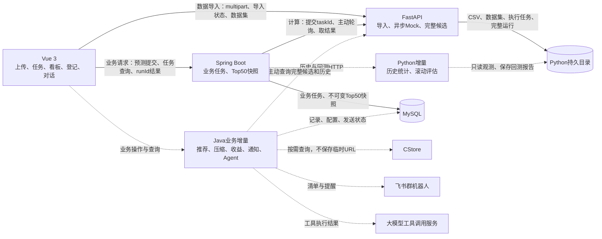

# CDN 热点预测系统架构

版本：20261021 v01。范围：架构与后续编码依据；本次不开发业务功能。

## 1. 依据、现状与差异

| 依据 | 用法与证据边界 |
|---|---|
| 仓库提交 `e8c5557` | 已提交实现基线；检查了前端入口、API、任务编排、存储和结果校验 |
| [考核题副本](../../materials/考核题：CDN%20热点文件动态预测与压缩降本系统.docx) | 需求依据，重点为 1.2、2.2、3.1～3.6；原 Windows 附件读取失败，未确认副本与原件的二进制一致性 |
| [方案 V1](../../materials/方案v1.md) | 设计基础；与用户本次粘贴内容按文本行比较一致，保留合理接口及职责 |
| [最小链路手测](../20261020_最小数据链路检查与手测说明_v01.md)、[第五环节 MySQL 验收](../20261020_第五环节MySQL联调验收_v01.md) | 历史证据，不能代替本轮或后续浏览器验收 |
| 本会话规划阶段快速回归 | Python 90 项、Java 核心 31 项、前端 38 项通过，前端构建通过；未包含真实 MySQL、实际 100 秒任务和浏览器验收；不是本次文档落盘时的新回归 |

读取考核题使用 `documents:documents` Skill，仅提取正文和表格；未改动 DOCX。

| 能力 | 已提交基线 | 本次规划的增量 |
|---|---|---|
| Python CSV | 真实解析、质量报告、不可变数据集、幂等及重启恢复 | 复用；不为历史看板复制原始数据到 Java |
| Python 预测 | 持久异步 Mock、完整候选与分页 | 保持 HTTP 和输入输出；真实算法由其他开发者负责 |
| Java 预测 | 任务落库、主动查询 Python、结果校验、Top50 事务快照 | 复用；另加业务投影，不重算模型 |
| Vue | 上传回执、手输 taskId/runId 查询、Fake 筛选榜单 | 补导入监控、数据集选择、预测提交及后续业务入口 |
| 历史、回测、CStore、压缩、收益、通知、Agent | 未发现已提交的对应业务实现 | 按独立模块逐个增加 |

**并行工作说明：**落盘前已看到未提交的 `algorithm_adapter.py`、`hotspot/`、`model_configs/`、PredictionStore 及 Java/Vue 模式兼容改动，另有[真实算法集成计划](../20261021_真实算法集成实施计划_v01.md)。它们属于其他进行中工作，本次不修改、不撤销，也不据此认定真实算法已验收。本套半天计划仍以 Mock 为执行默认；启动前重新核对其状态，保留兼容的 `modelInfo`、`resultMode` 等扩展，不能回退这些改动。

## 2. 系统架构与调用边界

下图为目标架构；虚线为本轮规划的新增能力，实线为既有核心链路。

`B` 与 `J` 是同一个 Spring Boot 进程；`A` 与 `P` 是同一个 FastAPI 进程，不新增服务。当前三服务、HTTP、MySQL 和 Python 持久目录足够；不加 Redis、MQ、注册中心、Celery 或通用任务框架。

| 所属端 | 唯一职责 | 不承担 |
|---|---|---|
| Vue | 展示、参数收集、直接上传 Python、轮询与失败重试交互 | 解析 CSV、预测、计算收益、直接访问数据库 |
| Java | 业务参数与 App 校验、持久任务、主动请求 Python、发布快照、业务状态、推荐过滤、收益、外部集成 | CSV 转发、读取 Python 文件、预测或重复实现评估公式 |
| Python | 标准化、质量检查、不可变数据集、历史聚合、完整候选、滚动执行与模型指标 | 压缩状态、收益、CStore、飞书、回调 Java |
| MySQL | Java 任务、运行快照和必要业务记录 | 全量原始观测副本、临时 CStore URL |

浏览器 `/data-api/* → Python /api/v1/*`，`/api/* → Java /api/v1/*`；沿用 Vite 现有代理。Java 直接访问 Python 服务地址。接口正文见各模块，不在总览复制完整 JSON。

## 3. 七条端到端链路

| 链路 | 用户触发、输入与请求路径 | 处理与持久化 | 输出 | 失败处理 |
|---|---|---|---|---|
| 1 CSV 导入 | 上传面板选择 CSV、列映射、REAL/FAKE、确认 B → 直接 POST Python | Python 原始文件及导入任务先落盘；解析后原子发布标准化文件、元数据与质量报告 | 202 importTaskId → 轮询成功 → READY datasetId、报告；刷新可选数据集 | 非法文件、冲突、错 App、超限均明确失败；失败不提供可用 datasetId；重试用原键。见[01](modules/01-data-import.md) |
| 2 历史流量 | 选择 datasetId、App、起止日，可选 fileKey → Vue → Java → Python | Python 从自身标准化快照按 App 聚合；不新建 MySQL 观测表 | 已观测流量趋势、观测 TopK、缺日；无权威总量不显示真实 App 占比 | 无观测返回 null/空集合和原因；依赖异常返回错误。见[02](modules/02-history-dashboard.md) |
| 3 日周预测 | Vue 选择 READY 数据集、App、截止日、1/7 天、版本 → Java POST | Java 持久任务；主动提交/查询同 taskId；Python 保存完整候选；Java 校验第一页并事务保存快照 | taskId → SUCCEEDED/runId → 不可变预测热点 Top50；日为下一自然日、周为后续连续七天 | 依赖暂不可用有界重试，总期限沿用；错契约失败，不发布半份榜单。见[03](modules/03-prediction-task.md) |
| 4 滚动回测 | 回测面板 → Java 提交 → Python 异步任务；输入同一 App、快照、截止日期序列和跨度 | Python 每折只读截止日前特征；用成熟目标窗口评价并保存报告；Java 主动查询，不重复计分 | 逐折、汇总指标、有效窗口数、来源与标签限制 | 缺日/截断标签不能补零；Mock 指标仅验证流程，不正式选模。见[05](modules/05-backtesting.md) |
| 5 推荐与压缩 | Vue 查询待压缩榜 → Java 查询完整候选、叠加处理状态；详情按需请求 CStore；人工登记压缩版本、大小和质量 | Java 过滤后向后补位；CStore URL 不落库；MySQL 保存压缩证据与状态；收益仅 Java 算 | 最多 50 条待处理项、文件预览/下载、压缩率、情景收益 | Python 不可用时不能用前50过滤结果冒充完整榜；身份未映射不能调用伪造 key；缺成本返回不可计算。见[04](modules/04-top50-recommendation.md)、[06](modules/06-file-access.md)、[07](modules/07-compression-registration.md) |
| 6 效果追踪 | 详情页人工登记七/三十天观测、访问、质量、流量口径、成本及证据 → Java | 观测随压缩记录保存；Java 区分未成熟、未知、通过、未通过，按相同窗口估算收益 | 效果列表、趋势及汇总；真实与测试证据分开 | 没有后续数据不视为零访问；未来窗口不认定通过；不称真实账单降本。见[08](modules/08-effect-and-benefit.md) |
| 7 飞书和 Agent | 定时/手动通知；用户自然语言提问；均进入 Java | 复用推荐、效果、回测服务；通知状态落库；大模型工具由 Java 执行；模型配置按 App 保存 | 清单、逾期提醒、带日期/版本/口径的回答；优化建议由用户确认 | 无当日运行明确无数据；发送结果未知不盲重试；无真实评价不允许正式切换。见[09](modules/09-feishu-notification.md)、[10](modules/10-agent-and-app-model.md) |

## 4. 标识、数据归属与最少存储

| 对象 | 归属及关系 | 存储与生命周期 |
|---|---|---|
| importTaskId | Python 导入任务 | 失败不发布 datasetId；持久查询和重试 |
| datasetId | Python 不可变数据快照，可含多个 App | 原 CSV、normalized.csv、metadata.json、quality.json；查询必须指定 App |
| taskId | Java 创建，同 ID 传 Python | 既有 prediction_task；Java/Python 分别保存业务/计算状态 |
| runId | Python 完整发布后生成 | Python 保存全候选，Java prediction_run 保存最多50条快照；原有接口不改为动态业务榜 |
| backtestId（拟议） | Python 创建并持久化 | Java 透传提交与主动查询，不复制一张回测任务表 |
| 压缩记录（拟议） | Java，绑定 App、精确 fileKey、运行来源和证据来源 | compression_record；观测数组随记录保存，最多七/三十天小规模证据 |
| App 配置（拟议） | Java，App 为独立业务 | app_config；日周版本、通知开关、处理时限、建议及确认信息 |
| 通知记录（拟议） | Java，绑定 App、业务日、类型、来源、运行 | notification_delivery；唯一业务键、请求摘要、次数、下次重试、结果 |
| 旧 Fake 表 | Java 原型查询 | top50_prediction 保留，不写入新链路、不作为真实证据 |

新表名是拟议名称。只有后续对应 Java 任务需要时编写独立增量 SQL；执行前另行确认目标库和影响范围。不改写已执行的003/004，不重新执行种子，不安装迁移框架。本轮不生成或执行 SQL。

## 5. 共用约定

- 标识均为字符串；日期为 `YYYY-MM-DD`，业务时区 `Asia/Shanghai`；时间戳使用 UTC ISO 8601。窗口首尾日期均包含。
- 观测流量为非负整数字节字符串，预测/估算允许非负十进制字节字符串；金额用十进制字符串，净收益可负；比例为0～1有限数值。
- `datasetSource=REAL/FAKE`、`predictionSource=MOCK/MODEL` 保持既有枚举。进行中扩展 `resultMode=MOCK/REAL` 如存在须与来源一致；REAL 模式不等于算法准确或已产生收益。
- 新业务证据使用 `evidenceSource=REAL/TEST`，不替代前两项来源。测试压缩记录不能改变真实业务处理状态；演示可显式选择 TEST 范围。
- 所有新业务接口必须携带 App，且核对 dataset/run/record 所属 App；不建设新认证中心，不把此校验冒充用户权限隔离。
- 保留原始身份；CSV URL 与 CStore key 的映射需要外部协议确认。无来源的大小、实际流量、质量、成本、占比返回 null 与原因，不伪造。
- HTTP 异常沿用 `{"error":{"code":"...","message":"..."}}`；新接口使用404不存在、409冲突/未就绪、413超限、422参数/业务不合法、429限流、503依赖不可用。后台错误位于任务 error。
- 旧 `/top50` 的错误形状和 FAKE 标签保留，前端兼容；不为本轮统一格式而重构旧接口。
- 缺失日期为无观测，未入 Top100 不代表零流量；文件行合计只能叫“已观测流量”。全量分母缺失时热点占比不可计算。
- 系统只承诺单实例 Java、单实例 Python 和有界后台处理，不扩展多实例协调、结果清理或断点续算。

模块矩阵见[module-boundaries.md](module-boundaries.md)，编码顺序见[development-plan.md](development-plan.md)。
