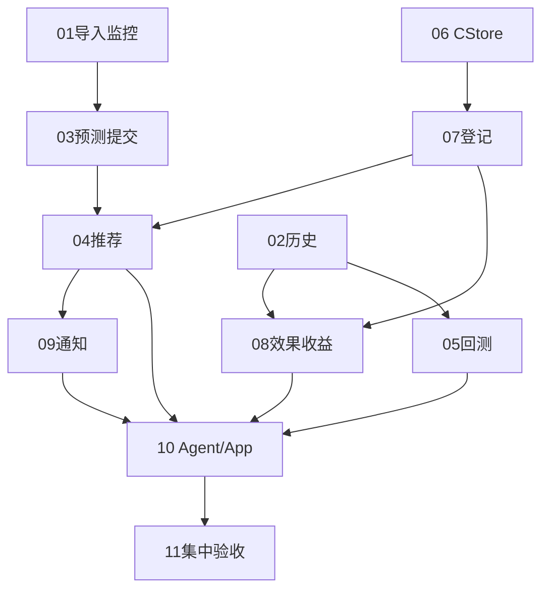

# 模块职责与能力边界

版本：20261021 v01。标为“拟议”的接口和表不是已经实现；状态证据及公共约定见[architecture.md](architecture.md)。

## 1. 考核要求覆盖矩阵

| 考核依据 | 功能归属 | 半天最小演示 | 正式验收仍需 |
|---|---|---|---|
| 1.2、2.1、3.1：半年Top100输入与分析 | [01导入](modules/01-data-import.md)、[02历史](modules/02-history-dashboard.md) | 真实小CSV、质量报告、按App观测趋势 | 正式半年数据、单位与完整性证明；大文件能力不在本轮默认限制内 |
| 1.2、2.2、3.1：日周待压缩Top50 | [03预测](modules/03-prediction-task.md)、[04推荐](modules/04-top50-recommendation.md) | Mock日/连续七天任务、完整候选、状态过滤与补位 | 真实预测及业务有效性证据，不能以Mock替代 |
| 1.2、3.1：严格滚动回测、方案比较、TopK指标 | [05回测](modules/05-backtesting.md) | 真实滚动执行器与指标函数，预测来源为Mock，标签不足显式不可计算 | 至少两个真实候选方案、足够成熟且可解释的标签和可复现报告 |
| 1.3、3.2：Spring Boot、MySQL、业务闭环 | [03](modules/03-prediction-task.md)、[07](modules/07-compression-registration.md)、[11交付](modules/11-delivery-verification.md) | 复用异步业务任务/快照，增量业务记录 | 目标环境迁移与完整浏览器链路验收 |
| 3.3.1：筛选及全部表格字段 | [04推荐](modules/04-top50-recommendation.md) | 真实运行筛选、App/日期/日周/版本/状态；未知字段保留null | 有来源的文件类型、大小、最近实际流量；Mock分数未知不能补值 |
| 1.2、3.3.1：CStore大小、预览、下载，≤100QPS | [06文件访问](modules/06-file-access.md) | 一条真实可映射文件按需访问，失败可见 | 实际协议、凭证、文件身份映射与调用证据 |
| 2.2、3.3.2：压缩登记与质量提示 | [07登记](modules/07-compression-registration.md) | 人工登记原/后大小、版本、质量、处理人、备注和来源 | 真实压缩及质量、访问证据；登记不等于有效压缩 |
| 2.2、3.3.3：7/30天有效访问、净收益与观测 | [08效果收益](modules/08-effect-and-benefit.md) | 人工观测证据、真实公式、测试与真实分开 | 成熟真实窗口、质量兼容性、成本与承接口径；账单降本另需对照 |
| 1.2、3.4：每日清单与超时提醒、可靠性 | [09飞书](modules/09-feishu-notification.md) | 测试群一条标明来源的消息、发送记录、逾期查询 | 定时实际运行及故障恢复证据；无数据不伪造清单 |
| 3.5：Top10、推荐原因、周流量、收益、准确率、逾期问答 | [10Agent](modules/10-agent-and-app-model.md) | 实时工具调用，回答带日期/粒度/版本/口径 | 对照真实API响应，禁止固定答案冒充Agent |
| 3.5：周期分析、按App优化与替换模型 | [05](modules/05-backtesting.md)、[10](modules/10-agent-and-app-model.md) | 定期读取评估并给出建议；Mock阶段阻断正式切换 | 真实候选已部署、可比真实评价、人工确认；自动替换不属本次授权范围 |
| 3.6：工程质量与交付 | [11交付](modules/11-delivery-verification.md) | 启动、接口、字典、回归和演示步骤、未完成清单 | 正式评估报告和答辩材料，不能以设计文档代替已实现证据 |

## 2. 模块输入、输出与职责矩阵

| 模块 | 输入 → 输出 | Vue | Java | Python | MySQL必要数据 | 必须兜底 | 完成证据 |
|---|---|---|---|---|---|---|---|
| 01 导入 | 原CSV/映射/单位/来源 → importTaskId、datasetId、报告 | 直传、轮询、选择READY | 不修改 | 复用真实解析、存储、幂等 | 不新增 | 超限、错误行、冲突、错App、断网 | 网络请求不经过Java；刷新可查报告 |
| 02 历史 | 数据集/App/日期/文件 → 观测合计、TopK、缺日 | 查询与简单趋势 | 参数/App校验，代理 | 唯一负责观测聚合 | 不复制观测 | 无数据、无全量分母 | 手算小样本与API一致 |
| 03 预测 | 五业务字段 → taskId→runId→快照 | 新增提交，复用轮询 | 复用持久编排及校验 | 复用Mock完整候选 | prediction_task、prediction_run | 幂等冲突、超时、坏结果 | 浏览器从数据集走到对应快照 |
| 04 推荐 | run/App/状态/证据范围 → 待处理Top50 | 运行列表和筛选 | 唯一负责过滤补位和业务投影 | 提供已有全候选分页 | 查询既有任务/快照及压缩记录 | 下游中断不伪装完整榜 | 压缩前50中的一条后第51补入 |
| 05 回测 | App/数据集/截止日序列/模型 → 逐折及汇总 | 提交、轮询、报告 | HTTP提交与查询，不另造任务表 | 唯一负责滚动/评价/报告存储 | 不新增 | 标签不足、未来泄漏、Mock选模 | 成熟窗口、手算指标、不可算原因 |
| 06 文件 | App/fileKey/用途 → 大小或临时URL | 详情、预览下载 | CStore适配、全局限流、错误脱敏 | 不修改 | URL不保存；登记可保存有时间的大小证据 | 无映射、过期、超限、凭证错误 | 真请求/限流/新鲜URL |
| 07 登记 | 原后大小/版本/质量/处理人 → 状态及压缩率 | 表单与提示 | 校验、质量判定、持久化 | 不修改 | compression_record及证据JSON | 无来源、非法大小、App不符 | 100MB→60MB得40%，刷新保留 |
| 08 效果 | 窗口/访问/原等价流量/承接/成本 → 估算与有效性 | 证据登记、统计 | 唯一负责金额及有效性 | 历史数据仅经模块02供给 | 观测随压缩记录保存 | 缺参数、未成熟、口径不明 | 精确公式、来源隔离、不确定分支 |
| 09 飞书 | 业务日/App/运行/类型 → 清单/发送记录 | 预览、手动发送、状态 | 调度、查询复用、Webhook、有限重试 | 不修改 | notification_delivery、app_config | 无当日榜、未知发送结果 | 一次测试群发送及重试/去重断言 |
| 10 Agent/App | 问题/App/上下文 → 有证据回答/配置建议 | 对话、App配置、确认 | 工具执行、模型调用、配置及切换门槛 | 复用回测/预测契约；不在本模块开发算法 | app_config，不新增聊天库 | 工具失败、无指标、越App、无真实模型 | 典型问答可追溯，Mock不能切正式模型 |
| 11 交付 | 各阶段证据 → 启动/验收/缺口清单 | 浏览器核验 | API/存储核验 | 数据/预测核验 | 只读核验，不擅自迁移 | 未验证不标通过 | 可复演操作与真实证据对应 |

## 3. 真实逻辑、Mock与简化

| 类别 | 本次采用 | 禁止混淆 |
|---|---|---|
| 真实逻辑 | CSV、质量、HTTP、持久化、历史聚合、异步状态、候选过滤、公式、观测登记、实际外部调用 | 不能把“接口返回成功”当作业务有效性证明 |
| Mock | 预测计算；最近一次已观测流量×horizonDays，候选不越截止日 | 预测来源始终MOCK；不产生正式准确率、真实降本或选模依据 |
| 回测简化 | 少量截止日、单进程、Mock预测、真实评价函数；观测代理指标单独命名 | 不能把截断周榜当真实周Top50；缺流量不补零 |
| 压缩简化 | 人工登记与有来源测试数据，不接转码平台 | TEST证据不改变REAL处理状态，不伪造压缩文件 |
| 效果简化 | 人工填写观测，默认7天，可选30天；小数组随记录保存 | 未成熟、无访问证据、成本未知不能判定有效 |
| 通知简化 | 单实例Spring定时器、Webhook、小发送记录表 | 不承诺外部系统严格恰好一次 |
| Agent简化 | 无记忆库、无向量检索、最多有限轮工具调用；写操作由页面确认 | 不用大模型自行算指标或修改模型代码 |

进行中的真实算法适配仅记录为现状变化，详见[架构现状](architecture.md)。后续接入若已验收，可直接复用MODEL来源和同一请求/响应，不在本套文档中安排重写。

## 4. 依赖与开发边界

每个模块依赖的是上述公开数据契约。Java通过内部业务服务复用自己的查询和公式，不要求同进程内HTTP自调；不得访问另一模块Repository绕过口径。Python只消费自身不可变标准化数据。所有单服务任务编号、范围和验收入口见[开发计划](development-plan.md)。

当前能力边界：默认5MiB/20,000行小CSV；一个部署中仅已配置的模型版本可用；不保证百万行导入、多个真实模型并存、生产权限体系、自动转码或真实账单归因。正式考核项目仍需补齐这些要求中与最终数据、真实模型及真实业务证据有关的部分，不能因半天计划而删除。
