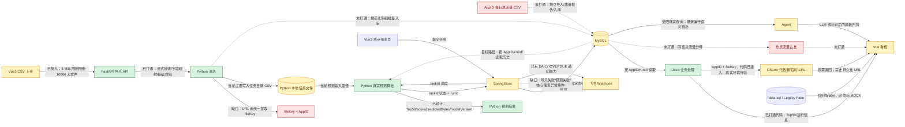

# CDN 热点预测系统全链路审查交接文档

> 审查日期：2026-10-22  
> 项目根目录：`/home/yukino/projects/work/cvte/cdn-hotspot-predictor`  
> 文档状态：`AUDIT_COMPLETE / IMPLEMENTATION_NOT_STARTED / RUNTIME_NOT_ACCEPTED`  
> 适用目标：考核验收前的现状审查、缺口定位与最小化实施交接

## 0. 交接边界与结论

本轮只形成审查与实施规划，没有修改业务代码、数据库结构或部署配置，也没有执行数据库迁移、提交或推送。

结论基于仓库代码、数据文件和本轮已有测试记录。没有当前运行证据的能力均标记为“待验证”，不能据此宣称已通过真实环境验收。

当前核心链路尚未达到完整验收状态，主要阻断点如下：

1. Python CSV 导入目前把原始 URL 当作文件标识保留，尚未按规范统一提取 `fileKey`。
2. 清洗后明细当前主要落在 Python 任务目录文件中，尚未形成“Python 清洗 → MySQL 明细 → Python 从 MySQL 预测”的闭环。
3. 两个 AppID 的每日总流量 CSV 已存在，但未接入业务数据库和 Java 指标接口，热点流量占比仍不可计算。
4. 前端上传上限为 5 MiB，会阻断约 107.7 MiB 的 `10066.csv`；Python 接收端配置能力更大，前后端限制不一致。
5. Agent 已有受限真实数据读取路径，但缺少“最新成功运行”语义和 LLM 不可用时的模板化兜底。
6. 飞书已有 Webhook、签名、限流和投递记录能力，但尚未覆盖导入失败、预测失败和核心服务异常三类验收事件。

本次实施应继续坚持：Python 负责数据清洗和 Top50 预测；Java 负责结果读取、业务计算、CStore、Agent 与告警；Vue 只负责交互和结果展示。禁止在 Java 中另写预测排序算法。

---

## 1. 当前系统实际完成度

| 功能模块 | 当前状态 | 实际文件 | 存在问题 | 是否阻断核心链路 |
|---|---|---|---|---|
| 项目说明、架构与开发计划 | 已实现 | `README.md`；`predictor/README.md`；`backend/README.md`；`20261021_架构与半天开发规划_v01/`；`materials/考核题：CDN 热点文件动态预测与压缩降本系统.docx` | 文档描述不能替代当前运行验收；部分旧计划已落后于代码 | 否 |
| Vue CSV 上传入口 | 部分实现 | `frontend/src/CsvImportPanel.vue`；`frontend/src/imports.js` | 有真实上传和轮询逻辑，但前端 5 MiB 限制会拦截大文件；字段映射交互未覆盖 URL → fileKey 规则 | 是 |
| Python 流式接收上传 | 已实现（代码） | `predictor/app/upload_stream.py`；`predictor/app/main.py` | 支持较大文件和行数限制，但本轮未完成真实大文件导入验收 | 待验证 |
| CSV 字段映射、校验和清洗 | 部分实现 | `predictor/app/csv_import.py`；`predictor/app/staged_csv.py`；对应测试 | 已处理编码、日期、数值、AppID、重复和日期缺口等；未规范解析完整 URL；当前标识策略仍可能保留 URL | 是 |
| fileKey 提取 | 未实现 | 主要缺口位于 `predictor/app/csv_import.py`、`predictor/app/staged_csv.py` | 缺少协议/域名/查询参数剥离、异常 URL 分类、转义保持、解析成功率及冲突统计 | 是 |
| 原始 URL 溯源 | 部分实现 | `predictor/app/import_store.py`；导入任务原始文件目录 | 原始上传文件可保留，但规范化记录没有稳定的 `sourceUrl`/解析状态字段 | 是 |
| 数据质量报告 | 部分实现 | `predictor/app/csv_import.py`；`predictor/app/import_store.py` | 有成功、失败、重复、日期等统计；缺少 URL 分类、fileKey 成功率、空路径、异常样本、归一化碰撞统计 | 是 |
| 重复导入幂等 | 已实现（代码） | `predictor/app/import_store.py`；导入 API 测试 | 有导入任务和指纹/状态机制；数据库端业务明细幂等尚未建立 | 是 |
| 清洗数据写入 MySQL | 未实现 | 当前 Python 导入链路及 `predictor/app/import_store.py` | 清洗结果主要落文件；没有以 `AppID + 日期 + fileKey` 为业务唯一键的 MySQL 明细闭环 | 是 |
| AppID 每日总流量导入 | 未实现 | 原始数据：`cvte-delivery-20261021/dataset/10066.csv`、`10350.csv` | 总流量 CSV 未进入统一导入、质量报告和数据库查询链路 | 是 |
| Python 生成的日汇总 | 部分实现 | `predictor/app/staged_csv.py` | `daily_totals` 是观测文件流量之和，不等于考核新增的独立 App 总流量分母，不能直接替代 | 是 |
| Python 日/周预测 | 已实现（代码） | `predictor/app/algorithm_adapter.py`；`predictor/app/prediction.py`；`predictor/hotspot/core/v1/`；模型配置目录 | 支持 AppID、1/7 天窗口、MODEL/REAL 结果语义；当前服务与数据库未运行，需重新验收 | 待验证 |
| 时间泄漏防护 | 已实现（代码） | `predictor/app/algorithm_adapter.py`；预测测试 | 预测输入按 cutoff 截断；仍需用真实任务记录复核输入最大日期 | 否，但必须验收 |
| `taskId → 轮询 → runId` | 已实现（代码） | Python：`predictor/app/prediction_store.py`；Java：`PredictionController.java`、`PredictionWorker.java`、`PredictorHttpClient.java` | 代码链路存在；当前服务未启动，未形成当日端到端证据 | 待验证 |
| Java 预测结果快照 | 已实现（代码） | `backend/src/main/java/com/yukino/cdn/prediction/PredictionRepository.java`；`PredictionResult.java`；迁移 `004_prediction_run.sql` | 可持久化运行结果；数据库迁移实际状态未知；热点占比字段仍为空 | 是 |
| Java Top50 读取 | 已实现（代码） | `PredictionRepository.java`；`PredictionService.java`；前端 `PredictionPanel.vue`、`Top50Table.vue` | Python 已负责排序，Java 读取快照；需防止与旧 Fake Top50 页面混淆 | 否，需联调 |
| 旧版 Top50 Fake 数据 | Mock | `backend/src/main/java/com/yukino/cdn/top50/Top50Service.java`；`backend/src/main/resources/data.sql`；`frontend/src/LegacyTop50Panel.vue` | 属于显式 Fake 演示，不能作为真实预测验收证据 | 否 |
| CStore 文件元数据/大小 | 部分实现 | `backend/src/main/java/com/yukino/cdn/files/CStoreClient.java`；`CStoreFileService.java`；`CStoreController.java` | 已有 v2 元数据调用及 `fSize` 映射方向；真实网络、鉴权和返回契约需目标环境复验 | 待验证 |
| CStore 临时访问 URL | 部分实现 | 同上；`frontend/src/components/CStoreFilePanel.vue`；`frontend/src/files.js` | 已有后端 v3 `downloadUrl` 调用、前端按需获取、禁止缓存/清空 URL 的设计；真实成功响应仍待验证 | 待验证 |
| CStore 限流 | 已实现（单实例） | `backend/src/main/java/com/yukino/cdn/files/CStoreLimiter.java` | 当前默认约 20 QPS、2 并发，低于 100 QPS；多实例部署没有全局限流 | 否，单实例可验收 |
| 热点流量占比 | 未实现 | Python `predictor/app/history.py`；Java `PredictionResult.java`；前端总览/预测页面 | 缺少独立分母入库、同窗计算、缺失原因和历史实际/未来预测区分 | 是 |
| AppID 数据隔离 | 部分实现 | Python 预测参数、Java Repository 查询、Vue 各页面本地状态 | 后端多数查询带 AppID；前端缺少统一活动 AppID 上下文，切页可能不同步 | 是 |
| 业务总览 | HYBRID/MOCK | `frontend/src/views/OverviewView.vue`；`HistoryPanel.vue`；`frontend/src/ui/mock-data.js` | 历史接口与演示 KPI 混合；实际占比、费用和收益不能被 Mock 冒充 | 否，需显式标识 |
| 热点预测看板 | 部分实现 | `frontend/src/views/PredictionView.vue`；`PredictionPanel.vue`；相关 API 模块 | 真实任务和结果流程存在；缺占比，上传大文件受阻，AppID 全局切换不完整 | 是 |
| 模型回测 | Mock/离线能力 | `frontend/src/views/BacktestView.vue`；`predictor/hotspot/evaluation/` | 有算法侧回测代码和前端演示，但未形成真实后端 API 与运行批次证据 | 否 |
| AppID 独立模型配置 | 部分实现 | `predictor/model_configs/hotspot-simple-v1/`；Java `appconfig/`；规划文档 | 有 AppID/预测周期配置及配置持久化接口；前端预测提交未完整消费配置，模型切换能力受限 | P1 |
| 压缩登记 | 已实现（业务登记） | Java `compression/`；前端 `CompressionRegistrationPanel.vue`、`CompressionView.vue` | 记录的是候选/登记/状态，不代表文件已执行真实压缩 | 否 |
| 压缩收益与降本 | HYBRID | Java `operations/`、`compression/`；前端压缩视图 | 可基于真实 Top50、真实大小和固定压缩率/单价计算估算；没有真实压缩和账单闭环 | 否，需标识假设 |
| Agent Top50 问答 | 部分实现 | Java `agent/AgentController.java`、`AgentService.java`、`AgentHttpClient.java`；前端 `AgentView.vue`、`agent.js` | 有白名单查询和业务证据约束；缺最新成功运行解析及 LLM 不可用时模板兜底 | 是 |
| 飞书 Webhook | 部分实现 | Java `notification/FeishuWebhookClient.java`、`NotificationService.java`、`NotificationScheduler.java`、`NotificationController.java` | 已有签名、限流、幂等、失败状态等；事件主要为 DAILY/OVERDUE，未覆盖三类核心失败告警 | 是 |
| MySQL 迁移 | 文件已存在，运行状态待验证 | `backend/src/main/resources/schema.sql`；`db/migrations/003_prediction_task.sql`、`004_prediction_run.sql`、`005_operations_notifications.sql` | 仓库未自动证明目标数据库已应用迁移；禁止在未审查前自动执行 | 是 |
| 本地运行与部署 | 未验收 | 根目录 README、各服务 README、配置文件 | 审查时 5173/8080/8000/13306 未形成可用全链路；外部 CStore、LLM、飞书也无当日成功证据 | 是 |

### 1.1 已检查 CSV 的实际结构

| 文件 | 对应 AppID | 日期范围 | 记录/日期情况 | 关键字段 | 结论 |
|---|---:|---|---|---|---|
| `datasets/10066.csv` | 10066 | 2026-01-01 至 2026-04-16 | 1,048,575 行；106 个日期；未发现日期缺口 | `url,日期,日流量,AppID` | 文件标识是完整 URL，必须在 Python 提取 fileKey；前端 5 MiB 限制会阻断上传 |
| `datasets/10350.csv` | 10350 | 2026-01-05 至 2026-10-13 | 4,478 行；248 个日期；34 个日期缺失 | `文件标识,日期,当日流量（B）,AppID` | 可能是普通标识或路径，仍需走统一解析器和质量报告 |
| `cvte-delivery-20261021/dataset/10066.csv` | 10066 | 2026-01-01 至 2026-10-19 | 292 个日期；未发现日期缺口 | `日期,AppId,费用,flux(GB)` | 可作为该 AppID 每日总流量分母候选，单位换算须显式确认 |
| `cvte-delivery-20261021/dataset/10350.csv` | 10350 | 2026-01-05 至 2026-10-19 | 257 个日期；31 个日期缺失 | `日期,AppId,费用,flux(GB)` | 缺日必须返回不可计算；部分日期存在明显分母一致性风险 |

补充判断：

- 两类 CSV 必须按 `AppID + 日期` 关联，严禁跨 AppID 混算。
- `flux(GB)` 是十进制 GB 还是 GiB，当前不能只凭字段名决定。代码和数据质量报告必须记录实际换算口径，例如 `GB_DECIMAL` 或 `GiB`。
- 10350 总流量中存在需人工复核的异常日期，包括 2026-07-10、2026-07-16、2026-07-17。若 Top50 分子大于分母，不应截断为 100%，应返回 `DENOMINATOR_INCONSISTENT`。
- Python 当前由观测明细求和得到的 `daily_totals` 只能表示“已导入文件集合流量和”，不能冒充“对应 AppID 全业务总流量”。

### 1.2 本轮测试和运行证据边界

- Vue 单元测试已有一次通过记录：14 个测试文件通过；生产构建已有一次成功记录。该证据证明前端代码基线可构建，不证明浏览器全链路验收完成。
- Python 回归执行后被用户中止，退出码为 `130`。必须记为“取消”，不能记为通过。
- Java 本轮未重新执行完整测试。旧报告中的通过数量只能作为历史参考，不能作为当前版本的完成声明。
- 本轮没有 MySQL 数据迁移执行证据，也没有真实 CStore、LLM、飞书 Webhook 成功证据。
- 因此系统当前不能标记为“全链路已通过”。

---

## 2. 核心业务数据链路



### 2.1 节点职责和输入输出

| 节点 | 输入 | 输出 | 依赖 | 当前断点 |
|---|---|---|---|---|
| Vue CSV 上传 | CSV、AppID、字段映射 | `importTaskId`（HTTP 202 仅表示接收） | FastAPI `/data-api/imports` | 大文件前端限制；不能把 202 当导入完成 |
| Python 清洗 | 原始 CSV 字节流 | 规范记录、错误样本、质量报告 | 编码/表头/日期/数值解析 | fileKey 未规范化；原始 URL 与业务 key 未分离 |
| MySQL 数据集 | 规范明细、App 每日总流量 | 可按 AppID/日期/cutoff 查询的数据 | 新增迁移、唯一键、批量写入 | 当前缺明细与独立总流量表闭环 |
| Python 预测 | AppID、维度、cutoff、历史数据、模型配置 | task 状态、runId、Top50、预测流量、分数、模型信息 | MODEL 模式、历史数据、模型配置 | 从 MySQL 读取未打通；运行环境待验 |
| Java 业务处理 | runId、Top50、总流量、CStore 元数据 | Top50 DTO、占比、大小、压缩估算 | MySQL、CStore | 占比未实现；外部接口待验 |
| Vue 看板 | 当前 AppID、维度、运行结果 | KPI、图表、Top50、预览/下载 | Java/Python API | AppID 上下文未统一；Mock/REAL 边界需加强 |
| Agent | AppID、维度、用户问题 | 带运行批次和来源的回答 | Java 真实查询、可选 LLM | 缺最新运行选择和模板兜底 |
| 飞书告警 | 真实异常事件 | 群消息、投递状态 | Webhook/签名/限流/重试 | 三类核心事件未接线；真实发送待验 |

### 2.2 fileKey 统一规则

唯一规范化入口必须位于 Python 导入服务，Java 和 Vue 不应重复实现解析逻辑。

建议规则：

1. 空值或全空白：标记 `EMPTY_FILE_KEY`，不进入有效观测数据。
2. 以 `http://` 或 `https://` 开头：使用标准 URL 解析器读取原始 path；忽略 query 和 fragment；只移除 path 开头的 `/`。
3. 普通 fileKey：去除外围空白和开头 `/`，其余内容保持，不做固定长度截取。
4. 异常 URL：标记明确错误，不以猜测方式截取域名或路径。
5. URL path 中的百分号转义默认按原始编码保存，除非 CStore 契约已明确要求解码；禁止无依据的多次解码。
6. 业务身份至少包含 `AppID + fileKey`；导入观测唯一性还应包含日期。
7. 原始 URL 只作为 `sourceUrl` 或原始文件溯源信息，不能作为长期有效的预览/下载地址。
8. 数据质量报告至少输出：总行数、空值数、完整 URL 数、普通 key 数、异常 URL 数、提取成功数、成功率、重复数、归一化碰撞数和错误样本。

示例：

```text
输入: https://easynote-store-bs.seewo.com/pro-ali-pri/encloud-162193381711225aa6202?token=xxx
输出 fileKey: pro-ali-pri/encloud-162193381711225aa6202
业务身份: AppID=10066 + fileKey=pro-ali-pri/encloud-162193381711225aa6202
```

### 2.3 热点流量占比定义

必须分开两个口径：

1. 历史实际 Top50 集中度：同一 AppID、同一日/周窗口内，按实际文件流量重新排序后的 Top50 实际流量之和 ÷ 独立总流量。
2. 预测命中 Top50 的实际流量占比：预测产生的 Top50 文件，在目标窗口结束并取得实际数据后，其实际流量之和 ÷ 同期独立总流量。

预测未来窗口尚未结束时，只能展示预测口径，例如“预测 Top50 流量占比”，不能标成“历史实际占比”。

日维度：

```text
actualHotspotRatio(day) =
  sum(actualBytes of selected Top50 files on day)
  / appTotalBytes(appId, day) * 100%
```

周维度：

```text
actualHotspotRatio(week) =
  sum(actualBytes of selected Top50 files in exact week window)
  / sum(appTotalBytes for the same AppID and exact week window) * 100%
```

不可计算条件必须返回 `null` 和原因码，不能补 0：

- `TOTAL_TRAFFIC_MISSING`
- `TOP50_ACTUAL_NOT_MATURED`
- `TOP50_ACTUAL_MISSING`
- `DENOMINATOR_INCONSISTENT`
- `UNIT_UNCONFIRMED`

---

## 3. P0 / P1 / P2 问题清单

### 3.1 P0：核心链路阻断，必须修复

| 编号 | 问题 | 具体文件 | 最小修改内容 | 验证方式 |
|---|---|---|---|---|
| P0-01 | Python 未提取 fileKey | `predictor/app/csv_import.py`；`predictor/app/staged_csv.py`；相关测试 | 新增单一规范化函数；输出 `fileKey/sourceUrl/parseStatus`；覆盖 URL、普通 key、空值、异常 URL、查询参数、转义和不同域名 | 单测逐类覆盖；对两个真实 CSV 生成质量报告并人工抽样 |
| P0-02 | 规范明细未写入 MySQL | Python 导入模块；新增后端迁移文件；Python 配置 | 增加最小数据集/观测表；以 `AppID + 日期 + fileKey` 幂等 UPSERT；原始 URL 可选溯源 | 重复导入两次，明细数和流量不翻倍；按 AppID/日期查询一致 |
| P0-03 | Python 预测未从 MySQL 闭环读取 | `predictor/app/algorithm_adapter.py`；`prediction.py`；新增数据访问层 | 优先从规范明细按 AppID 和 cutoff 读取；保留显式文件模式用于兼容，不允许静默切换 | 关闭本地规范 CSV 后仍能完成 MODEL 预测；输入最大日期不超过 cutoff |
| P0-04 | 每日总流量未入库 | Python 新增总流量导入逻辑；新增迁移；质量报告 | 解析 `日期,AppId,费用,flux(GB)`；确认单位；按 AppID+日期唯一；保留缺失日 | 两份附件导入后逐 AppID 对账；缺日可查询且不补 0 |
| P0-05 | 热点流量占比未实现 | Java `prediction/` 或新建最小指标类；Repository；DTO；前端预测/总览页 | 用 `BigDecimal` 同窗计算；区分历史实际与预测口径；不可计算返回原因码 | 日/周边界测试；跨 AppID 测试；缺分母、分子大于分母和未成熟窗口测试 |
| P0-06 | 前端无法上传真实大 CSV | `frontend/src/CsvImportPanel.vue`；`frontend/src/imports.js` | 将大小限制与 Python 配置一致或由后端返回；保留进度和错误说明；增加 10066 映射预设 | 浏览器选择真实 10066 CSV，不在前端被误拦截；服务端限制仍生效 |
| P0-07 | 数据库迁移状态未知 | 只读检查目标 MySQL；迁移文件 | 先审查表、列、索引、重复数据；确认后再单独申请执行新增迁移 | `SHOW CREATE TABLE`、索引和重复键查询留存；不得自动迁移 |
| P0-08 | Agent 验收问题不能稳定兜底 | `AgentService.java`；`AgentController.java`；测试 | 解析 AppID/日周；查询最新成功 run；取真实 Top50 前 5；LLM 不可用时模板化回答并标识 | 关闭 LLM 后仍返回真实 DB 数据和 `responseMode=TEMPLATE`；无数据返回解释性错误 |
| P0-09 | 三类核心飞书告警未接线 | 导入边界、`PredictionWorker.java`、健康/异常边界、`NotificationService.java` | 新增事件类型 `IMPORT_FAILED/PREDICTION_FAILED/CORE_SERVICE_DOWN/TEST`；异步或事务后投递；有限重试 | 受控触发每类异常；确认投递记录；Webhook 失败不回滚主业务 |

### 3.2 P1：考核官新增要求，优先补齐

| 编号 | 问题 | 具体文件 | 最小修改内容 | 验证方式 |
|---|---|---|---|---|
| P1-01 | AppID 切换不是全局一致 | `frontend/src/App.vue`；`frontend/src/ui/context.js`；各视图 | 建立单一 activeAppId；路由页统一读取；切换时重新加载 KPI、Top50、图表和明细 | 10066/10350 来回切换，所有网络请求和标题同步变化 |
| P1-02 | CStore 新旧标识边界不清 | Java `files/`；前端 `CStoreFilePanel.vue` | 新数据只接受规范 fileKey；旧数据若需兼容，显式标记 `URL_PATH/MAPPED`，禁止静默猜测 | 请求日志不含临时 URL/Token；同名 key 在不同 AppID 下查询独立 |
| P1-03 | CStore 真实契约未验收 | `CStoreClient.java`；配置和测试 | 用目标环境逐层验证 v2 元数据、v3 URL、错误码、超时、鉴权、过期；凭据只来自环境变量 | 单文件真实请求成功才标 `REAL`；无法访问时明确 `MOCK`，不声称可下载 |
| P1-04 | 总流量单位未确认 | 总流量导入模块、配置、质量报告 | 配置并持久化单位口径；拒绝未确认单位参与占比 | 已知样本换算对账；单位未知返回 `UNIT_UNCONFIRMED` |
| P1-05 | 老导入数据不满足新语义 | Python import store、数据集状态 | 缺 `daily_totals` 或 `fileKey` 版本过旧的数据集标记不可预测或要求重导 | 老数据集不会被误当新格式继续计算 |
| P1-06 | 预测提交未完整消费 App 模型配置 | Java `appconfig/`、`prediction/`；前端预测表单 | 读取当前 AppID 配置；只传现有算法支持参数；未生效配置显式标 Mock | 任务记录展示配置快照；模型结果只受真实生效参数影响 |
| P1-07 | 预览/下载 URL 生命周期需前端验收 | `CStoreFilePanel.vue`；`files.js` | 每次点击按需获取；关闭面板清空；不进 localStorage/数据库；过期后允许刷新 | 浏览器网络面板验证每次请求；页面源码/存储中无持久 URL |

### 3.3 P2：可 Mock 演示或暂缓

| 编号 | 功能 | 处理建议 | 验收说明 |
|---|---|---|---|
| P2-01 | 高级模型调参 | 可 Mock | 只展示稳定配置和是否生效；不得暗改真实 MODEL 输出 |
| P2-02 | 多模型效果对比 | 可 Mock | 用固定演示结果，字段兼容未来真实 API，明确 `resultMode=MOCK` |
| P2-03 | 完整回测可视化 | HYBRID | 可用真实导入数据和离线算法结果；没有真实运行记录时不得称正式准确率 |
| P2-04 | 物理文件压缩执行 | 可 Mock | 只模拟任务状态，不得声称 CStore 文件已被修改 |
| P2-05 | 压缩效果追踪 | HYBRID | 真实 Top50/文件大小 + 固定压缩率假设；展示“估算” |
| P2-06 | 账单级降本收益 | HYBRID/暂缓 | 可用可配置单价估算；没有真实账单对账时不得称已节省 |
| P2-07 | Agent 复杂多工具分析 | 暂缓 | 本次只保证一个受限、可追溯的 Top50 问答 |
| P2-08 | 高级图表与动画 | 暂缓 | 不影响真实数据链路验收 |

---

## 4. 真实功能与 Mock 功能划分

| 功能 | REAL / HYBRID / MOCK / 暂缓 | 最小实现方案 | 演示效果 | 后续替换成本 |
|---|---|---|---|---|
| CSV 上传与 fileKey 清洗 | REAL | Vue 上传，Python 标准解析、校验、质量报告和幂等入库 | 展示成功/失败/解析率/错误样本 | 低，属于正式数据入口 |
| App 每日总流量导入 | REAL | Python 导入附件总流量 CSV，按 AppID+日期入库 | 展示日期范围、缺日、异常和单位 | 低 |
| Python 日/周预测 | REAL | 复用 `hotspot-simple-v1`，按 AppID/cutoff 从真实历史数据预测 | 任务轮询后展示真实 Top50、模型版本、runId | 低 |
| Java Top50 读取与聚合 | REAL | 读取 Python 结果快照，不重算排名 | Top50 页面和 API 一致 | 低 |
| 历史实际热点流量占比 | REAL | 真实 Top50 实际分子 + 独立 App 总流量分母，同窗计算 | 日/周趋势；缺失显示不可计算 | 低 |
| 未来预测流量占比 | REAL 或明确预测口径 | 预测 Top50 预估流量 ÷ 对应预测窗口总量估计；若无总量预测则不展示 | 标题必须含“预测” | 中 |
| AppID 隔离与切换 | REAL | 全局 App 上下文；所有请求带 AppID | 切换后 KPI、图表、Top50、明细同步 | 低 |
| CStore 文件大小 | REAL（成功验证后） | Java 按 AppID+fileKey 调 CStore v2；本地短缓存和限流 | Top50 行展示真实大小 | 中，受内部接口环境影响 |
| CStore 预览/下载 | REAL 或显式 MOCK | Java 按需请求 v3 临时 URL；无法访问企业网时返回 MOCK 模式 | 点击后新开或下载；Mock 时明确不可真实下载 | 中 |
| 压缩候选登记 | REAL | 对真实 Top50 建立业务登记，不执行物理压缩 | 状态可持续、跨页一致 | 低 |
| 压缩效果 | HYBRID | 使用真实 fileKey/大小，固定且可追溯的压缩率规则 | 完整任务交互，标识“估算/模拟执行” | 中 |
| 降本收益 | HYBRID | 真实流量/大小 + 固定单价/压缩率假设 | 展示估算值和参数来源 | 中 |
| 物理压缩 | MOCK | 固定规则驱动状态流转，`resultMode=MOCK` | 可演示创建、执行、完成、失败 | 高，未来需接真实压缩基础设施 |
| 模型回测 | HYBRID | 算法真实离线计算，前端图表可简化 | 展示窗口、样本数、指标来源 | 中 |
| 多模型比较 | MOCK | 基于当前 AppID、日期和真实 Top50 生成固定演示结构 | 可切换表格/图表，不宣称真实训练 | 中 |
| 高级调参 | MOCK | 参数面板保存展示配置，明确 `effective=false` | 配置交互完整 | 中 |
| Agent Top5 查询 | REAL/HYBRID | 真实 DB 查询；LLM 成功则自然语言，失败则模板回答 | 明确 AppID、维度、runId、数据源和回答模式 | 低 |
| Agent 复杂分析 | 暂缓 | 不实现自主规划和任意工具调用 | 只保留能力边界提示 | 高 |
| 飞书核心异常告警 | REAL | 真实异常事件接 NotificationService 和真实 Webhook | 群收到含事件/AppID/taskId/摘要的消息 | 中 |
| 每日/逾期通知 | REAL/HYBRID | 保留现有调度和通知中心；无外部发送证据时标待验证 | 通知中心可查看投递状态 | 低 |

### 4.1 Mock 模块统一约束

所有 Mock/HYBRID 响应建议保留以下公共字段：

```json
{
  "resultMode": "REAL | HYBRID | MOCK",
  "appId": "10066",
  "dimension": "DAY | WEEK",
  "runId": "optional-real-run-id",
  "assumptions": [],
  "dataSource": "MYSQL | CSTORE | FIXED_RULE | TEMPLATE",
  "generatedAt": "ISO-8601"
}
```

规则：

- Mock 数据必须由 `AppID + 日期/窗口 + runId/fileKey` 做稳定派生，禁止刷新随机变化。
- 同一 fileKey 的压缩状态只能有一个可追溯来源，避免多个页面相互矛盾。
- 固定压缩率、单价、准确率等必须放入 `assumptions`，不能包装成真实发生值。
- CStore 模拟 URL 必须使用不可误认的演示域名或禁用真实打开，并显示 `MOCK`。
- 飞书只有收到真实成功响应并记录投递成功时，才能显示“发送成功”。

---

## 5. 最小开发任务列表

以下任务按依赖顺序排列。每项均可单独交给 Codex 实施；完成一个任务后必须停下验收，不自动进入下一项。

### T00：目标 MySQL 只读基线审计

- 目标：确认现有表、迁移版本、字段、索引、数据量和重复情况。
- 涉及文件：不修改文件；只读查看 `backend/src/main/resources/schema.sql`、`db/migrations/*.sql` 和目标 MySQL。
- 输入：只读数据库连接配置。
- 输出：表结构清单、迁移状态、冲突风险和建议 DDL；不得执行 DDL/DML。
- 修改边界：禁止清库、删表、覆盖 seed、自动迁移。
- 验收标准：保存 `SHOW TABLES`、`SHOW CREATE TABLE`、索引、主键和重复键查询证据。
- 依赖：无。

### T01：Python fileKey 规范化与质量报告

- 目标：由 Python 唯一负责完整 URL/普通 key/空值/异常 URL 的规范化。
- 涉及文件：`predictor/app/csv_import.py`、`predictor/app/staged_csv.py`、`predictor/tests/test_csv_import.py`、`predictor/tests/test_staged_csv.py`。
- 输入：CSV 原始标识、AppID、日期、流量。
- 输出：`fileKey`、`sourceUrl`、`parseStatus`、质量统计和错误样本。
- 修改边界：不改 Java/Vue，不改数据库；不做固定长度截取，不无依据解码 URL。
- 验收标准：示例 URL 正确提取；不同域名、query、fragment、空值、异常 URL、转义、碰撞均有测试；两个真实 CSV 生成可核验报告。
- 依赖：无。

### T02：每日总流量 CSV 解析与质量报告

- 目标：将两份附件识别为独立分母数据，不与 Top100/Top50 明细混淆。
- 涉及文件：Python 新增或最小扩展导入模块及测试。
- 输入：`日期,AppId,费用,flux(GB)` CSV。
- 输出：AppID、日期、总流量统一数值、单位口径、缺失日期、异常记录。
- 修改边界：本任务先不写库；不得缺日补 0。
- 验收标准：10066/10350 日期范围和缺失日可复现；单位未确认时拒绝产出可计算状态；异常日可定位。
- 依赖：无。

### T03：新增规范数据表迁移方案

- 目标：用最少新增表支持数据集、文件日观测和 App 日总流量。
- 涉及文件：`backend/src/main/resources/db/migrations/` 新增一个顺序迁移；必要时增加测试 schema。
- 输入：T00 基线、T01/T02 字段定义。
- 输出：可审查的增量 DDL，业务唯一键至少覆盖 `AppID + 日期 + fileKey` 和 `AppID + 日期`。
- 修改边界：不改已有表语义，不自动执行，不删除或改写历史数据。
- 验收标准：DDL 在隔离测试库可重复验证；索引支持 AppID+日期查询；大整数/小数不丢精度。
- 依赖：T00、T01、T02。

### T04：Python 批量入库与从库读取预测输入

- 目标：打通“清洗 → MySQL → 预测输入”。
- 涉及文件：Python 导入/预测模块、配置、测试；不改算法核心排序逻辑。
- 输入：T01 规范明细、T02 日总流量、T03 表结构。
- 输出：幂等入库结果、数据库数据集 ID、按 AppID/cutoff 读取的预测输入。
- 修改边界：保留现有任务 API；不得静默从 MODEL 降级为 Mock；百万行采用有界批次。
- 验收标准：同一文件导入两次不累计；10066 大文件内存受控；预测输入最大日期不超过 cutoff；服务重启后数据仍可查询。
- 依赖：T03。

### T05：Java 热点流量占比

- 目标：按 AppID 和完全相同窗口计算日/周历史实际占比。
- 涉及文件：Java `prediction/` 或新建小型指标服务、Repository/DTO、对应测试；前端 API 类型。
- 输入：预测/实际 Top50 选择、文件实际流量、App 日总流量。
- 输出：数值、口径、窗口、分子、分母、状态/原因码。
- 修改边界：使用 `BigDecimal`；不改 Python 排名；不对缺失数据补 0；不把预测称为实际。
- 验收标准：日/周、跨月、缺日、跨 AppID、分子大于分母、单位未知均有测试。
- 依赖：T04。

### T06：Vue 大文件上传与全局 AppID 上下文

- 目标：真实上传两个 CSV，并让一级导航共享同一 AppID。
- 涉及文件：`CsvImportPanel.vue`、`imports.js`、`App.vue`、`ui/context.js`、各一级视图。
- 输入：用户选择文件、AppID、字段映射。
- 输出：importTaskId、轮询结果、质量报告；全局 activeAppId。
- 修改边界：不修改 API 主契约；HTTP 202 只显示“已接收”；不得失败后静默展示 Fake。
- 验收标准：真实 10066 CSV 能进入上传；切换 AppID 后 KPI、Top50、图表、明细请求全部一致。
- 依赖：T01、T04。

### T07：CStore 单文件真实验收

- 目标：用新规范 `AppID + fileKey` 验证文件大小、预览和下载。
- 涉及文件：Java `files/`、前端 `CStoreFilePanel.vue`、相关测试和环境配置说明。
- 输入：AppID、规范 fileKey、环境变量凭据。
- 输出：元数据或临时 URL；明确 REAL/MOCK 和错误码。
- 修改边界：不持久化、不记录临时 URL；不硬编码 Cookie/Token；限流不超过 100 QPS。
- 验收标准：目标网络中至少一个真实文件成功；不可达/鉴权失败/不存在/过期均给出解释；Mock 不宣称真实可下载。
- 依赖：T01、T04。

### T08：Agent 最新预测 Top5 真实问答

- 目标：稳定回答指定验收问题，并保留真实数据来源。
- 涉及文件：`AgentController.java`、`AgentService.java`、Agent DTO/测试、`AgentView.vue`。
- 输入：问题文本、当前 AppID、维度。
- 输出：AppID、维度、最新成功 runId、前 5 fileKey/预测流量、数据来源、回答模式。
- 修改边界：不实现开放式 SQL 或复杂自主规划；LLM 不得生成事实字段。
- 验收标准：LLM 可用时组织真实数据；不可用时模板回答；无运行记录时返回可解释错误，不虚构。
- 依赖：T04、现有 Java 预测快照。

### T09：核心异常飞书告警

- 目标：覆盖导入失败、预测失败、核心服务异常和人工测试告警。
- 涉及文件：Java `notification/`、预测 Worker、导入代理/边界、健康检查、测试；必要时 Vue 通知中心。
- 输入：真实异常事件或受控测试请求。
- 输出：包含事件类型、AppID、时间、taskId、摘要的消息和投递记录。
- 修改边界：Webhook/Secret 仅环境变量；有限重试；发送失败不影响主业务事务；测试告警必须显式标识。
- 验收标准：真实 Webhook 返回成功且群收到才标成功；失败状态可查；重复事件不会造成消息风暴。
- 依赖：T04；可与 T08 并行但每次只批准一个任务实施。

### T10：HYBRID/MOCK 展示收口

- 目标：让回测、压缩、降本和高级配置形成一致、可复现、如实标识的演示。
- 涉及文件：相关 Java DTO/API、`frontend/src/ui/mock-data.js`、回测/压缩视图。
- 输入：当前 AppID、维度、真实 runId/Top50 和固定演示参数。
- 输出：统一 `resultMode`、`assumptions`、稳定状态流转。
- 修改边界：不得虚构物理压缩、实际账单节省或正式准确率。
- 验收标准：刷新结果稳定；跨页面状态一致；UI 明确展示 REAL/HYBRID/MOCK。
- 依赖：T05、T06。

### T11：全链路运行与验收证据

- 目标：在可访问 MySQL、CStore、LLM/模板和飞书的环境中完成一次可复现验收。
- 涉及文件：原则上只补验收文档、启动配置说明和必要测试；不在此任务混入新功能。
- 输入：两个真实 CSV、数据库、服务配置、外部服务凭据。
- 输出：导入 taskId、datasetId、预测 taskId/runId、Top50、占比、CStore 结果、Agent 回答、飞书消息和截图/日志摘要。
- 修改边界：不把单元测试、HTTP 202、Mock URL 或历史运行记录当成全链路成功。
- 验收标准：按第 6 节脚本逐步通过；每一步保留请求、响应、数据库或浏览器证据。
- 依赖：T00 至 T10 中所有 REAL 必需项。

---

## 6. 最终考核演示脚本

> 下列是目标演示脚本。当前尚有 P0 缺口，未完成对应任务前不能宣称脚本已通过。

| 步骤 | 操作 | 预期界面效果 | 真实接口/数据 | 验证方式 |
|---:|---|---|---|---|
| 1 | 在“数据导入”选择 AppID 10066，上传真实 `datasets/10066.csv` | 显示上传进度；返回“已接收”，不直接显示导入成功 | `POST /data-api/imports`；HTTP 202；返回 `importTaskId` | 浏览器网络面板确认真实文件和 taskId；文件不被 5 MiB 前端限制拦截 |
| 2 | 等待导入任务完成 | 展示成功/失败/重复数、fileKey 解析率、URL/普通 key/异常样本、日期范围 | `GET /data-api/imports/{importTaskId}` 或现有轮询接口 | MySQL 按 AppID/日期抽查；重复导入后行数和总量不翻倍 |
| 3 | 一级导航切换 AppID 10066/10350 | 总览、预测、回测、压缩、Agent 的当前 AppID 同步 | 各 API 请求统一携带 AppID | 网络面板检查；两 App 数据不串用 |
| 4 | 在“热点预测”选择日维度并提交，再选择周维度提交 | 展示任务排队/运行/完成；保留 taskId | `POST /api/predictions`，Java 调 Python 预测 API | 请求中含 AppID、维度、cutoff；Python 输入最大日期不超过 cutoff |
| 5 | 轮询完成并查看 Top50 | 表格展示 rank、fileKey、score、predictedBytes、modelVersion、runId、`resultMode=REAL` | 预测任务状态接口及 `GET /api/predictions/{runId}` | MySQL 结果快照与 Python 返回逐项一致；Java 不重新排序 |
| 6 | 查看热点流量占比 | 日/周趋势展示分子、分母、窗口和口径；缺数据时显示“不可计算”原因 | 目标接口如 `GET /api/predictions/{runId}/hotspot-ratio` | 用 SQL/离线计算复核同一 AppID 同一窗口；不得补 0或混 AppID |
| 7 | 在 Top50 中选择一个文件查看大小并点击预览/下载 | 先展示真实大小；点击后按需获取临时 URL；失败显示具体原因 | Java 文件元数据/访问 URL API → CStore v2/v3 | 确认请求使用 AppID+fileKey；数据库和日志无临时 URL；真实成功才标 REAL |
| 8 | 将该文件加入压缩候选并演示状态 | 展示真实 fileKey/大小和估算压缩率、估算节省；状态跨页一致 | `POST /api/compressions`、`PUT /api/compressions/{id}` 或现有契约 | 页面明确 `HYBRID/MOCK`；不得声称实际文件已压缩或费用已节省 |
| 9 | 在 Agent 输入指定问题 | 回答包含 AppID=10066、DAY、最新成功 runId、Top5 及预测流量、数据来源、回答模式 | `POST /api/agent/query` 或现有 Agent API；真实 DB 查询 | 将回答中的前 5 与预测结果 API 对账；关闭 LLM 后模板兜底仍基于真实数据 |
| 10 | 在通知中心人工触发测试告警 | 页面先显示发送中，收到 Webhook 成功响应后才显示成功；飞书群收到测试消息 | 目标接口如 `POST /api/alerts/test` → Feishu Webhook | 群消息含 `TEST`、AppID、时间、操作者/任务信息；Webhook 失败时页面显示失败且主业务不回滚 |

### 6.1 Agent 验收问题

```text
查询 AppID 10066 最新一次日维度预测的 Top50 文件，并总结排名前 5 的热点文件及其预测流量。
```

回答至少应包含：

- `AppID: 10066`
- `dimension: DAY`
- 最新成功 `runId`
- 运行完成时间和模型版本
- 前 5 的 rank、fileKey、predictedBytes
- `dataSource: MYSQL` 或等价真实来源
- `responseMode: LLM` 或 `TEMPLATE`

### 6.2 飞书测试消息最低字段

```json
{
  "eventType": "TEST",
  "appId": "10066",
  "occurredAt": "2026-10-22T...+08:00",
  "taskId": "manual-test-or-related-task-id",
  "summary": "CDN hotspot predictor acceptance test",
  "resultMode": "REAL"
}
```

### 6.3 演示时禁止使用的表述

- HTTP 202 返回后禁止说“CSV 已导入成功”；只能说“上传已接收，正在处理”。
- 没有 MySQL 证据时禁止说“数据已持久化”。
- `PREDICTION_MODE=MOCK` 或旧 `data.sql` 结果禁止说“真实模型预测”。
- 模拟 URL 禁止说“CStore 真实文件可下载”。
- 固定压缩率/单价计算禁止说“已真实节省费用”。
- 未收到飞书成功响应或群消息时禁止说“告警发送成功”。
- 被中止的测试禁止说“测试通过”。

---

## 7. 配置、安全与回退要求

- CStore Cookie、Token、飞书 Webhook/Secret、LLM API Key、数据库密码全部通过环境变量或未提交的本地配置提供。
- 日志不得输出临时下载 URL、Cookie、Token、完整 Webhook 或密钥。
- 所有数据库修改使用新增顺序迁移；执行前先做只读影响审查并取得明确批准。
- 每个任务独立提交、独立测试、可单独回退；不要在同一任务跨 Python、Java、Vue 大范围重构。
- REAL 接口失败时返回明确错误或不可用状态，不得静默切换到 Mock。
- 如需 Mock，只能通过显式配置启用，并在 API 和页面展示 `resultMode=MOCK`。
- CStore 临时 URL 只允许在单次响应和前端内存中短暂存在，禁止写入 MySQL、localStorage 或持久日志。

---

## 8. 推荐验收证据清单

最终交付至少保留下列证据：

1. 两个 CSV 的 SHA-256、大小、表头、AppID、日期范围和质量报告。
2. fileKey 解析样例及异常样本，包含给定示例 URL。
3. MySQL 表结构、唯一键、导入前后计数及重复导入对账。
4. 日/周预测提交请求、taskId、状态轮询、runId 和 Top50 响应。
5. Python 预测输入最大日期、模型版本、配置摘要和 `resultMode=REAL`。
6. Java/MySQL Top50 快照与 Python 返回一致性对账。
7. 日/周热点流量占比分子、分母、窗口和手工复核结果。
8. CStore 单文件真实元数据、真实临时 URL 获取结果和错误场景；证据须脱敏。
9. Agent 回答与真实 Top50 前 5 的逐项对账。
10. 飞书群收到的测试告警和真实失败告警，以及后端投递记录。
11. Vue、Java、Python 的测试输出和生产构建输出。
12. 浏览器从上传到告警的完整操作录屏或逐步截图。

---

## 9. 交接状态

本文件是审查和最小实施规划，不是完成证明。

- 已完成：代码与数据链路审查、REAL/HYBRID/MOCK 边界、P0/P1/P2 分级、任务拆分、演示脚本。
- 未完成：P0 实施、数据库迁移、服务联调、浏览器验收、CStore/LLM/飞书真实外部验收。
- 下一步：由项目负责人明确批准一个独立任务后再实施；不得自动进入后续任务，不得同时修改多个服务。

