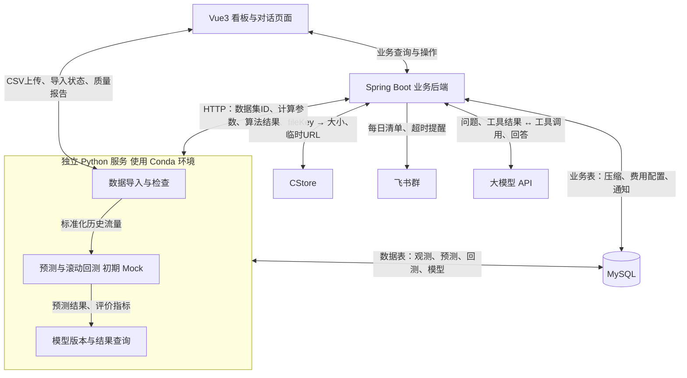

# 1. 系统最小化第一版方案

核心分工：**Python 负责CSV上传、导入查询、数据处理与预测，Java负责业务和外部系统，前端按职责分别访问两个服务。**

数据入口固定为：**上传及导入查询直达Python，业务操作走Java。CSV文件不经过Java。**

当前处于初期最小化验证阶段：

- 数据导入、字段映射、去重、完整性检查使用真实实现。

- 预测算法和回测计算先使用 Mock 实现。

- Mock 只作为 Python 内部的临时计算实现；对外使用正式接口契约，Java 不增加 Mock 专用判断。联调环境与用途写入开发说明，示例结果不用于证明真实预测效果。

- 后续在保持接口结构不变的前提下，替换真实算法。

- Python 服务的开发、运行、测试和容器环境统一使用 Conda。

## 1.1 系统解决什么问题

用历史流量判断未来哪些文件值得提前压缩，再记录处理结果、估算收益、提醒漏处理，最后通过回测持续调整预测方案。

最小业务闭环：

**导入数据 → 预测热点 → 筛选待压缩文件 → 人工压缩并登记 → 跟踪效果与收益 → 通知和问答 → 评估并调整模型。**

初期通过 Mock 预测结果验证整个流程能否贯通，不用 Mock 数据论证模型表现或真实降本效果。

## 1.2 系统结构与选型



| 部分 | 选型 | 具体用途 |
|---|---|---|
| 前端 | Vue3 + Element Plus + ECharts | 表格、筛选、表单、趋势图、对话页 |
| 业务后端 | Java 21 + Spring Boot | 业务接口、压缩记录、收益、调度、外部集成、Agent |
| Python 服务 | Conda + Python 3.11 + FastAPI + pandas + NumPy | 直接接收前端CSV及导入查询；通过HTTP向Java提供预测、回测及历史流量 |
| 数据库 | MySQL | 一套数据库，按归属区分 Python 数据表与 Java 业务表 |
| 定时任务 | Spring `@Scheduled` | 触发预测、发送通知、扫描超时、模型审查 |
| 服务通信 | HTTP + JSON，上传使用 multipart | 无须消息队列或共享文件目录 |
| 部署 | Docker Compose | 前端、Java、Python、MySQL 四个容器；Python 容器内使用 Conda 环境 |

FastAPI用于提供Python服务的HTTP入口。当前先实现CSV上传、导入状态和质量报告查询，并保留预测、回测的占位接口；后续将真实算法封装并接入约定的FastAPI接口，Java继续使用同一契约，不接收或转发CSV文件。

数据库约定：Python 写数据与模型相关表，Java 写业务表；跨服务获取数据走 HTTP，不互相修改对方的表。前端导入页直接访问Python；榜单、压缩、收益、通知和Agent等业务页面访问Java。

Conda 用于统一 Python 解释器、依赖及计算库环境。算法性能取决于具体算法、NumPy 等计算库的底层实现和硬件配置，不预设更换环境管理工具就能提升性能。

## 1.3 最小模块及各自输入输出

| 模块／归属 | 输入明细 | 输出明细 | 负责什么 |
|---|---|---|---|
| **数据导入／Python** | 前端直接上传的CSV、列名映射、缺少时明确提供的App ID、正式/测试数据标识 | `datasetId`；标准化记录：日期、App ID、fileKey、流量 B；质量报告：有效/重复/异常行数、缺失日期、每日条数、完整性状态 | 接收并保存上传文件，映射字段、检查身份、去重、发现缺日，直接向前端提供导入状态和质量报告 |
| **热点预测／Python** | `datasetId`、App ID、截止日、跨度 `1/7` 天、模型版本 | `runId`、预测起止日；每个候选的 fileKey、排名、预测流量 B、分数、推荐依据、模型版本 | 初期返回固定规则生成的 Mock 结果；后续实现昨日值、近七日均值、EWMA 三种方案 |
| **回测与模型管理／Python** | 数据批次、App ID、回测起止日、跨度、候选算法及参数 | 每折指标、汇总指标、有效窗口数、报告；当前版本、历史版本、切换记录 | 初期验证接口及版本流程；后续实现严格的时间滚动回测，按 App ID＋跨度维护模型 |
| **榜单与文件查询／Java** | 前端筛选条件；Python 预测结果；文件 App ID＋fileKey | Top50、文件详情、历史趋势、最近实际观测、压缩状态；CStore 实时大小与临时 URL | 合并预测和业务状态，提供统一查询、预览与下载入口 |
| **压缩与收益／Java** | 原/压缩后文件标识及大小、质量指标、处理人、完成/上线时间、成本参数；Python 流量数据 | 压缩率、质量状态、处理状态、观察窗口、预期净收益、效果估算和缺失说明 | 登记压缩证据，关联新旧文件，跟踪是否有效 |
| **任务与通知／Java** | 新预测、待处理文件、处理时限、通知配置 | 每日清单、超时提醒；任务状态、重试次数、错误原因、发送记录 | 定时触发业务流程，防重复、处理失败、提供任务页 |
| **Agent／Java** | 用户问题或定期审查请求；业务查询工具；Python 回测结果 | 带数据日期、跨度、模型版本的回答；模型优化建议；符合规则的版本切换结果 | 调工具查系统数据，在预置方案中按规则优化模型 |
| **页面／Vue3** | Python返回的导入信息、Java返回的业务数据、用户操作 | 导入页、Top50 页、详情/效果页、模型页、任务页、对话页 | 展示结果与提交操作，不在前端计算收益或选模型 |

Python 的质量报告必须区分：**当天完整 Top100 中未出现**和**当天数据缺失**。这两种情况都不能直接补成真实零流量。

**统一接口原则：**Mock 和真实算法使用相同的请求、响应字段、字段类型、单位、分页方式和任务流程；不增加用于区分实现方式的业务字段，也不通过模型版本名称让 Java 识别 Mock。Python 通过内部配置选择计算实现。

`modelVersion` 只表示业务算法及参数版本，不承担环境模式判断。联调时可用目标模型版本的示例结果占位；开发说明和 Python 日志记录实际启用的实现，不能将这些示例当作该模型已实现的证据。

## 1.4 数据具体怎么流转

### ① CSV上传与导入查询直达Python

**前端选择CSV → 直接提交Python FastAPI → Python保存文件并创建导入任务 → 校验、标准化、落库 → 前端直接查询Python展示状态及质量报告。**

Java不接收CSV，不做文件转发，不保存原始文件，也不重复实现字段映射和数据检查。

用户上传CSV时，按实际字段提供列名映射，例如：

```json
{
  "date": "日期",
  "appId": "App ID",
  "fileKey": "文件路径",
  "trafficBytes": "当日流量"
}
```

注意单位：**1 GB = 1000 MB = 10⁹ B。**

Python对外提供以下最小导入接口：

| Python接口 | 调用方与输入 | 输出或用途 |
|---|---|---|
| `POST /api/v1/imports` | 前端；multipart上传`file`，以表单字段传`mapping` JSON字符串、`datasetKind`，必要时传缺省`appId` | HTTP 202，返回`taskId`、`status`；文件已保存，任务已持久化 |
| `GET /api/v1/imports/{taskId}` | 前端；导入任务ID | `taskId`、`status`、`datasetId`、`error`；成功后才返回可用的数据集ID |
| `GET /api/v1/datasets/{datasetId}/quality` | 前端；成功导入的数据集ID | 有效/重复/异常行数、缺失日期、每日条数、完整性状态等质量报告 |
| `GET /api/v1/datasets` | 前端；分页参数 | 已导入数据集及其可用状态，供刷新页面后重新选择 |

`mapping`与文件使用同一个multipart请求，不将文件嵌入JSON。Python使用FastAPI的文件/表单参数接收，不依赖Java解析。初期可以预填已确认的字段映射；CSV缺少App ID时必须明确提供，不能猜测。

导入任务查询成功示例：

```json
{
  "taskId": "import_001",
  "status": "SUCCEEDED",
  "datasetId": "ds_001",
  "error": null
}
```

等待或运行中时`datasetId`和`error`均为null；失败时`datasetId`为null，`error`给出稳定错误码和可读原因。导入状态使用`PENDING / RUNNING / SUCCEEDED / FAILED`。该接口返回`datasetId`；后面的预测任务返回`runId`，二者不可混用。

Python负责上传大小限制、CSV解析、字段映射、去重、完整性检查以及文件和数据的持久化。重复冲突、字段异常和不完整日期都要在报告中可见，不能静默丢弃。上传接口支持幂等，失败重试不重复导入。

**导入成功后的衔接：**前端持有`datasetId`；用户执行预测等业务操作时，将`datasetId`和App、截止日、跨度等参数提交给Java。Java通过Python接口确认该数据集存在且可用，然后创建预测任务；原始CSV始终由Python管理，Java无需再次获取文件。无需增加Python主动通知Java的回调。

### ② 提交预测任务并查询算法结果

交互采用 Java 主动请求、Python 返回响应，不增加 Python 主动回调 Java 的机制：

**提交预测 → 返回 taskId → 查询任务状态 → 成功后按 runId 查询预测结果。**

Mock 阶段同样创建真实任务、保存结果并支持查询；只替换计算步骤，不直接在 HTTP 入口硬编码一份成功响应。后续替换真实算法时，Java 的提交、轮询、结果接收和榜单聚合代码不需要调整。

以下 JSON 均为目标接口契约的示例，不表示真实算法已经实现。

#### A Java 提交预测请求

前端先向Java提交预测业务操作及所选`datasetId`；Java再调用以下Python接口。前端不直接创建预测或回测任务。

`POST /api/v1/predictions`

请求头：

```http
Content-Type: application/json
Idempotency-Key: predict-ds001-10066-20261018-7-lastday-v1
```

请求体：

```json
{
  "datasetId": "ds_001",
  "appId": "10066",
  "cutoffDate": "2026-10-18",
  "horizonDays": 7,
  "modelVersion": "last_day_v1"
}
```

| 字段 | 类型 | 含义 |
|---|---|---|
| `datasetId` | string | 不可变的数据批次或快照，确定本次计算使用的数据 |
| `appId` | string | 本次预测所属业务 |
| `cutoffDate` | string，YYYY-MM-DD | 仅允许使用该业务日期及以前的观测 |
| `horizonDays` | integer，1或7 | 预测下一天或未来连续七天 |
| `modelVersion` | string | 明确指定算法、参数及数据处理口径的版本 |

上述请求的目标窗口为 10 月 19—25 日。`last_day_v1` 是目标模型版本示例；联调时 Python 内部可以使用 Mock 实现提供同结构结果，Java 不判断该版本是否由 Mock 实现提供。

`Idempotency-Key` 在同一逻辑请求重试时保持不变：相同键及相同请求体返回已有任务；相同键配不同请求体返回 HTTP 409，避免误复用结果。Python 先校验数据批次和参数；不满足条件的请求直接返回明确错误，不生成假成功任务。

#### B Python 接收任务的响应

HTTP `202 Accepted`：

```json
{
  "taskId": "task_001",
  "status": "PENDING"
}
```

这里只表示任务已经持久化并接收，不表示预测计算已经成功。Mock 可以很快执行完成，但提交与查询流程保持一致。

#### C Java 查询任务状态

`GET /api/v1/tasks/task_001`

成功响应：

```json
{
  "taskId": "task_001",
  "status": "SUCCEEDED",
  "runId": "run_001",
  "error": null
}
```

失败响应：

```json
{
  "taskId": "task_001",
  "status": "FAILED",
  "runId": null,
  "error": {
    "code": "PREDICTION_EXECUTION_FAILED",
    "message": "预测执行失败，请查看任务日志"
  }
}
```

- 等待中、运行中：`runId` 和 `error` 均为 `null`。

- 成功：返回 `runId`，其对应结果已完整保存并可查询。

- 失败：`runId` 为 `null`，返回稳定错误码与可读说明，不暴露内部异常堆栈或凭证。

- `taskId` 用于查询执行情况，`runId` 用于查询计算结果；失败任务可以没有有效结果。

#### D Java 查询预测结果

`GET /api/v1/predictions/run_001/items?page=1&pageSize=1`

下面用一页一条记录展示完整结构，实际请求可使用 `pageSize=50`：

```json
{
  "runId": "run_001",
  "datasetId": "ds_001",
  "appId": "10066",
  "cutoffDate": "2026-10-18",
  "horizonDays": 7,
  "predictionStartDate": "2026-10-19",
  "predictionEndDate": "2026-10-25",
  "modelVersion": "last_day_v1",
  "generatedAt": "2026-10-18T16:05:00Z",
  "items": [
    {
      "fileKey": "videos/example.mp4",
      "rank": 1,
      "predictedBytes": "5000000000",
      "score": 0.92,
      "reason": "近七天多次入榜，近期流量较高"
    }
  ],
  "page": 1,
  "pageSize": 1,
  "total": 120
}
```

| 字段 | 类型与约定 | 实际用途 |
|---|---|---|
| `runId` | string | 绑定一份发布后不可变的预测结果 |
| `datasetId`、`appId`、`cutoffDate`、`horizonDays`、`modelVersion` | 与请求同义 | 让结果本身可追溯，避免查询或组合时串用其他预测 |
| `predictionStartDate`、`predictionEndDate` | YYYY-MM-DD，首尾均包含 | 看板、收益和通知复用同一窗口 |
| `generatedAt` | UTC时间戳 | 区分数据截止日与结果生成时间 |
| `items[].fileKey` | string | 与App ID一起关联业务记录和CStore文件 |
| `items[].rank` | integer，从1开始 | 全部候选中的全局排名，不是当前页内序号 |
| `items[].predictedBytes` | 非负十进制字符串，单位B | 该预测窗口的累计流量估计，Java使用BigDecimal接收；不先换算GB或舍入 |
| `items[].score` | 有限number | 展示模型排序分数，不解释为概率，不默认跨模型可比 |
| `items[].reason` | string | 算法提供的推荐依据，供看板及Agent使用 |
| `page`、`pageSize`、`total` | integer；page从1开始 | 分页获取候选，total表示本次运行全部候选数 |

候选按预测流量降序排列；相同预测流量用精确fileKey的固定次序打破并列，保证重复查询和跨页排名稳定。空候选使用 `items: []`、`total: 0`，不构造虚假文件凑满50条。

Python 保存可分页查询的候选预测，不只返回前50。Java才能在排除已有效压缩的文件后，继续读取后续候选补足待压缩Top50。

Python 不在预测结果中返回压缩状态、文件实时大小、CStore临时URL、CDN单价或净收益；这些由Java查询或计算后补充。

#### E Mock 实现与后续替换

Python 内部统一计算入口，例如：

```python
def predict(history, parameters):
    """输入标准化历史数据与参数，返回统一结构的候选预测列表。"""
```

初期调用 `algorithms/mock.py`，后续调用 `last_day.py`、`mean7.py`、`ewma.py`。任务、落库、校验和结果序列化使用同一套代码。

Mock 实现应满足：

- 相同数据快照、截止日、跨度和模型参数产生相同候选及数值；任务ID、运行ID和生成时间不要求跨独立运行相同。

- 候选文件仅从截至 `cutoffDate` 已出现的文件中选择，包含截止日当天。

- 保留正式响应的完整字段及其类型、单位、排序和分页语义。

- 仅在Python配置和内部日志中记录使用Mock，不向请求或响应加入实现模式字段。

- Java、Vue和Agent按正式业务契约开发，不按版本名前缀或环境模式增加Mock专用分支。

联调环境的数据与结果独立保存，开发说明注明本阶段只验证工程链路，不用占位结果证明真实准确率或降本。启用真实实现后重新生成结果，不复用Mock产生的历史结果。正式业务的周期选模在真实回测可用后启用；联调环境可以验证同一套规则和切换流程。

#### F 回测遵循同一交互原则

回测同样使用“提交任务 → 查询任务 → 查询结果”，Mock与真实回测共用契约：

| 接口 | 输入或输出 |
|---|---|
| `POST /api/v1/backtests` | 请求：`datasetId`、`appId`、`cutoffStartDate`、`cutoffEndDate`、`horizonDays`、`modelVersions`；响应：`taskId`、`status` |
| `GET /api/v1/tasks/{taskId}` | 与预测任务相同，成功返回回测的`runId` |
| `GET /api/v1/backtests/{runId}` | 返回数据批次、App、回测截止日范围、跨度、生成时间、各模型的逐折与汇总指标 |

回测中的起止日均指历史预测截止日；每一折都向后预测1或7天。输出按模型分组，固定包含 `modelVersion`、`validFoldCount`、`metrics` 和 `folds`。每折包含 `cutoffDate`、`predictionStartDate`、`predictionEndDate`、`status` 和 `metrics`。

`metrics` 固定使用 `precisionAt50`、`ndcgAt50`、`top50TrafficCaptureRate` 三项；没有有效标签或分母为零时返回 `null`，不得把未知写成0。另用 `evaluationBasis` 表明业务评价口径：`DAILY_TOP50`表示已确认完整日榜的评价，`OBSERVED_WEEKLY_TOP50`表示截断观测下的周代理评价；它说明指标含义，与Mock实现无关。

回测Mock只构造符合上述结构的联调结果。后续补充真实滚动切分与指标计算时，不修改Java接收结构。详细字段在 `docs/api-contract.md` 中统一维护，预测和回测均不增加Mock专用返回字段。

### ③ 生成待压缩清单

Python 返回按预测流量排序的候选：

**App ID、fileKey、预测流量、分数、理由、模型版本、预测窗口。**

Java 加入：

**压缩状态、文件类型、处理时限、成本假设、预计收益。**

随后形成两种视图：

- **热点 Top50**：直接展示预测排名；真实算法上线后用于评价模型。

- **待压缩 Top50**：从候选中排除已有效处理等不可执行项，向后补足最多 50 项。

文件大小、预览和下载在用户请求时由 Java 查询 CStore；临时 URL 不入库。

清单聚合与收益计算按正式字段执行，Java不根据算法实现模式增加分支。本阶段产生的清单与金额仅作为联调样例，其用途在开发说明和演示环境说明中注明。

### ④ 登记压缩与查看效果

用户提交：

**压缩后 fileKey、压缩后大小、质量指标、处理人、备注、成本。**

Java 获取并保存对应的原文件大小，计算压缩率；用户确认上线后，记录：

**上线时间、新旧文件映射、访问检查结果。**

效果页再组合：

**Python 提供的窗口内流量观测 + 压缩记录 + 价格参数。**

输出：

**压缩率、访问情况、观察是否结束、收益估算、计算假设、哪些项目未知。**

公式：

$$
\text{预期净收益}
=
\frac{\text{预计原版流量 B}\times\text{压缩版本承接比例}\times\text{压缩率}}{10^9}
\times 0.02
-\text{转码成本}
-\text{新增存储成本}
$$

价格发生变化或缺少承接比例等必要参数时，显示“无法确定／情景估算”，不能默认成本为零。

预测流量来自 Mock 时，计算结果仅用于验证公式与页面流程，不代表真实预期收益。

### ⑤ 通知与 Agent

通知模块直接读取同一份待压缩清单和待办状态，发送每日摘要；超过时限仍未处理则提醒，失败保留记录并重试。

Agent 的查询链路：

**用户问题 → LLM 选择工具 → Java 查询业务数据或调用 Python → 工具返回结构化结果 → LLM 解释。**

模型优化链路：

**Java 定时触发审查 → Python 返回各 App 的成熟回测指标 → Agent 提出候选 → 服务端校验切换规则 → Python 更新当前模型版本 → 下一轮预测生效。**

切换规则不满足则保持原模型，并说明原因。

初期使用独立联调环境验证模型审查和切换流程，Java与Agent共用正式接口，不通过响应模式字段识别Mock。开发说明记录当前算法为占位实现；正式业务的周期选模在真实算法及回测验证完成后再启用，联调结果不迁入正式评价数据。

---

所有预测结果带上**数据批次、截止日、预测跨度、模型版本**；回测结果带上对应的回测范围和模型版本。重试使用同一请求标识，避免重复导入、重复计算或重复切换。

实现顺序：先打通 **CSV → Python → Mock 预测 → Java → 表格**，再接压缩收益、CStore、飞书，最后接 Agent；真实预测算法和回测计算随后替换。

一键启动、迁移脚本和回测报告随开发补齐；正式数据、CStore 协议与凭证未到齐前，演示结果须明确标注来源。

# 2. 项目代码结构

无视 `/cvte/cdn-hotspot-predictor/materials` 路径下的所有文件。

`/cvte/cdn-hotspot-predictor` 采用一个 Git 仓库、三个独立工程：`frontend`、`backend`、`predictor`。各自能单独启动，通过 HTTP 联调，最后用 Compose 一起启动。

Python 工程统一使用独立 Conda 环境，不在 `base` 环境中安装项目依赖。

## 2.1 项目代码结构

```text
cdn-hotspot-predictor/
├── README.md                    # 环境、启动、导入、演示步骤
├── AGENTS.md                    # 给 Codex 的项目约定
├── .gitignore
├── .editorconfig                # 编码、缩进、换行约定
├── .env.example                 # 配置示例，不放真实密钥
├── compose.yaml                 # 四个容器的一键启动
│
├── frontend/                    # Vue3 工程
│   ├── package.json
│   ├── package-lock.json
│   ├── vite.config.ts
│   └── src/
│       ├── api/
│       │   ├── dataApi.ts        # Python：上传、导入状态、数据集与质量报告
│       │   └── businessApi.ts    # Java：业务操作、榜单与任务查询
│       ├── views/
│       │   ├── ImportView.vue
│       │   ├── HotspotView.vue
│       │   ├── FileDetailView.vue
│       │   ├── ModelView.vue
│       │   ├── TaskView.vue
│       │   └── AgentView.vue
│       ├── components/          # 确实复用的组件
│       ├── router/
│       └── utils/               # 日期、字节、金额展示
│
├── backend/                     # Spring Boot 工程
│   ├── pom.xml
│   ├── mvnw
│   ├── mvnw.cmd
│   ├── Dockerfile
│   └── src/
│       ├── main/
│       │   ├── java/com/yukino/cdn/
│       │   │   ├── CdnApplication.java
│       │   │   ├── config/      # 安全、HTTP客户端、配置绑定
│       │   │   ├── common/      # 异常、错误响应、traceId
│       │   │   ├── hotspot/     # 榜单、详情、趋势聚合
│       │   │   ├── compression/ # 压缩登记、上线与状态
│       │   │   ├── benefit/     # 收益与效果计算
│       │   │   ├── model/       # 模型审查与切换规则
│       │   │   ├── task/        # 调度、通知任务与重试
│       │   │   ├── agent/       # 对话、工具定义和执行
│       │   │   └── integration/
│       │   │       ├── predictor/
│       │   │       ├── cstore/
│       │   │       ├── feishu/
│       │   │       └── llm/
│       │   └── resources/
│       │       ├── application.yml
│       │       └── db/migration/ # 统一数据库迁移入口
│       └── test/
│
├── predictor/                   # 独立 Python 工程，统一使用 Conda
│   ├── environment.yml          # Conda 环境与直接依赖声明
│   ├── Dockerfile               # 容器内创建并使用同名 Conda 环境
│   ├── app/
│   │   ├── __init__.py
│   │   ├── main.py              # FastAPI入口，注册路由
│   │   ├── config.py
│   │   ├── db.py
│   │   ├── ingestion/           # 直接接收CSV、导入任务、质量检查与查询
│   │   ├── forecast/            # 预测流程、统一输出与排名
│   │   │   └── algorithms/
│   │   │       └── mock.py      # 初期 Mock，后续增加真实算法
│   │   ├── evaluation/          # 初期 Mock 回测，后续实现真实指标
│   │   ├── model_registry/      # 算法参数、版本、当前绑定
│   │   └── tasks/               # 计算任务、执行与恢复
│   └── tests/
│
├── fixtures/                    # 可提交的脱敏、小规模测试数据
├── docs/
│   ├── architecture.md
│   ├── api-contract.md          # 服务间接口与字段约定
│   ├── data-dictionary.md
│   └── evaluation-report.md
└── runtime/                     # 原始文件、报告、日志；不提交Git
```

Java 按业务模块组织，启动类放在根包；Python 使用模块和路由拆分，Python 包目录按需要添加 `__init__.py`。

这些是目录规划，按开发需要逐步创建，不必先建一堆空文件。

真实算法开发时，再在 `algorithms/` 下增加：

```text
algorithms/
├── mock.py
├── last_day.py
├── mean7.py
└── ewma.py
```

当前不要求提前实现这三种真实算法。

## 2.2 每个业务模块内部怎么写

Java 以压缩模块为例：

```text
compression/
├── CompressionController.java  # 接收请求、校验参数、返回结果
├── CompressionService.java     # 状态变化和业务规则
├── CompressionRepository.java  # 数据库读写
├── CompressionRecord.java      # 持久化记录
├── RecordCompressionRequest.java
└── CompressionResponse.java
```

调用方向固定为：

**Controller → Service → Repository／外部 Client**

- Controller 不写收益公式、SQL 或外部调用细节。

- Service 处理业务规则和事务。

- Repository 只负责数据读写。

- `integration/` 只处理外部协议、超时、鉴权和错误转换。

Python 同样保持简单：

```text
ingestion/
├── __init__.py
├── router.py       # HTTP入口
├── schemas.py      # 请求、响应模型
├── service.py      # 导入流程
├── repository.py   # 数据读写
└── validation.py   # 字段、重复、完整性检查
```

预测算法写成可独立调用的函数：**输入标准化历史数据与参数，输出预测结果。**

算法代码不依赖 FastAPI 请求对象，也不直接调用 Java，这样本地脚本、回测和服务接口可以复用同一套计算。

初期 `mock.py` 与后续真实算法使用一致的输入输出结构，由Python配置选择实现。Java Controller、Service、页面和Agent不增加Mock专用分支；Python算法之外的任务、存储和序列化流程保持一致。

## 2.3 先固定这几个工程边界

| 边界 | 约定 |
|---|---|
| 前端访问 | 上传、导入状态、数据集与质量报告查询直达Python；业务操作走Java；不访问数据库 |
| CSV导入 | 前端直接上传Python；文件保存、字段映射、去重、质量检查与导入查询全部由Python负责，Java不转发 |
| Python 数据 | 自己维护上传文件、数据集、观测、预测、回测、模型和计算任务 |
| Java 数据 | 自己维护压缩记录、费用配置、通知和操作审计 |
| 跨服务查询 | Java凭datasetId等标识调用Python HTTP接口，不获取原始CSV、不读取或修改对方的业务表 |
| 费用计算 | 统一由 Java `benefit` 模块计算，页面和 Agent 共用 |
| 模型切换 | Java 校验切换规则，Python 保存当前版本及历史 |
| 定时触发 | Java 统一触发；Python 负责执行计算，避免双方重复调度 |
| Python 环境 | 开发、启动、测试、算法脚本和容器统一使用 Conda |
| Mock 边界 | 只替代Python内部预测算法和回测计算；不改变HTTP契约，不替代真实导入、任务、持久化与查询 |

数据库可以使用 `data_`、`biz_` 表名前缀区分归属。共用一个 MySQL，并不意味着两个服务可以随意互写。

前端统一封装两个客户端：`dataApi`处理Python导入接口，`businessApi`处理Java业务接口。开发时使用Vite代理，部署时使用前端容器的Nginx分流：

| 浏览器请求前缀 | 转发目标 | 示例映射 |
|---|---|---|
| `/data-api` | Python | `/data-api/imports` → Python `/api/v1/imports` |
| `/api` | Java | `/api/predictions` → Java `/api/v1/predictions` |

代理仅重写并转发路径，不承担CSV解析或业务计算。“直达Python”指文件不经过Java；经同源Vite/Nginx代理不改变这个边界。Python服务内的`/api/v1`接口路径保持不变，Java调用Python也继续使用这些路径。

如果启用登录保护，Python上传与导入查询接口也需在服务端校验凭证；Java的登录保护不会自动覆盖Python接口。

## 2.4 工程化开发最需要注意的事项

### 1．先写接口约定，再分头开发

在 `docs/api-contract.md` 中先约定：

- 请求和响应字段、类型、必填项。

- 前端直达Python的导入接口，以及经Java执行的预测和业务接口边界。

- 日期、字节、金额单位。

- 任务状态和错误码。

- 分页规则、重试方式。

- 预测和回测的正式返回结构，以及Mock与真实实现共用契约的约定。

字段语义统一：

| 字段 | 约定 |
|---|---|
| `appId` | 字符串，避免丢失前导零 |
| `fileKey` | 稳定文件标识，不使用临时 URL |
| `cutoffDate` | 输入数据截至日期 |
| `horizonDays` | `1` 或 `7` |
| `datasetId` | 不可变的数据批次或快照 |
| `modelVersion` | 算法＋参数＋处理口径的版本 |
| 流量／大小 | 数据库使用B；API字段带`Bytes`；预测流量按十进制字符串传输 |
| 金额 | 后端十进制计算；API 可用字符串保留精度 |
| BIGINT ID | JSON 中统一用字符串 |

业务日期按上海时区解释，执行时间用带时区的时间戳，避免“日榜差一天”。

### 2．数据库建表只有一个执行入口

最小方案采用 Java Flyway 管理全部 SQL 迁移，Python 表的变更也提交到同一迁移目录：

```text
V1__create_data_tables.sql
V2__create_business_tables.sql
V3__add_model_binding_revision.sql
```

Python 运行时不自动建表或修改表结构。

已经执行并共享的迁移不修改，新增迁移完成变更。

迁移统一管理，数据写入仍按服务归属划分。

### 3．耗时任务必须可查询、可恢复

导入、预测、回测采用：

**提交 → 返回 taskId → 后台执行 → 查询状态**

最小状态：

```text
PENDING / RUNNING / SUCCEEDED / FAILED
```

Python 先保存任务，再执行；重启后能识别未完成任务。初期单计算 worker 即可，不能只把任务放在内存中。

预测结果全部成功后才发布；失败不覆盖上一份有效结果。前端上传Python或Java提交计算任务发生超时时，使用原请求标识查询或幂等重试，不能创建重复任务。导入查询由前端直达Python；预测及回测任务查询仍由Java对前端提供。

Mock 算法虽然执行很快，也沿用相同任务接口，避免后续换成真实算法时重新修改调用链路。

### 4．锁定环境，保留独立启动能力

- Java：JDK 21、Maven Wrapper。

- Python：Conda 管理独立环境，提交 `predictor/environment.yml`。

- 前端：固定 Node 版本，统一 npm，提交 `package-lock.json`。

- 数据库和容器镜像锁定具体版本。

Python 环境统一命名为：

```text
cdn-predictor
```

不使用 `base` 环境运行项目，不再使用 uv 管理项目环境，也不另外创建 `.venv`。

#### Conda 环境声明

`predictor/environment.yml` 初始内容示例：

```yaml
name: cdn-predictor
channels:
  - conda-forge
  - nodefaults
dependencies:
  - python=3.11
  - fastapi
  - python-multipart
  - uvicorn
  - pandas
  - numpy
  - pymysql
  - pytest
```

`python-multipart`用于接收文件与表单字段，参见[FastAPI文件与表单文档](https://fastapi.tiangolo.com/tutorial/request-forms-and-files/)。

此文件是初始依赖声明，不是精确版本锁文件。环境验证通过后，应记录实际依赖版本，作为联调与验收依据。

后续增加真实算法依赖时，更新该文件并验证，不为尚未使用的算法提前安装大量依赖。

#### 创建与启动

在项目根目录执行：

```bash
cd predictor
conda env create -f environment.yml
conda activate cdn-predictor
python -m uvicorn app.main:app --reload --host 127.0.0.1 --port 8000
```

更新依赖：

```bash
conda env update -n cdn-predictor -f environment.yml --prune
```

运行测试：

```bash
conda run -n cdn-predictor python -m pytest
```

上述环境文件创建、更新及 `conda run` 方式以 Conda 官方环境管理能力为依据。[conda 26.9.3 documentation](https://docs.conda.io/projects/conda/en/stable/user-guide/tasks/manage-environments.html?utm_source=chatgpt.com)

#### 环境复现

需要精确复现某个已验证平台的环境时，可导出显式依赖清单。例如，在 Linux x86_64 环境执行：

```bash
conda list -n cdn-predictor --explicit > conda-linux-64.lock.txt
```

恢复该平台环境：

```bash
conda create -n cdn-predictor --file conda-linux-64.lock.txt
```

显式清单与操作系统、CPU 架构有关，不能将 Linux 清单直接用于 Windows 或 macOS。按实际平台命名，并在验证后提交。

#### 本地与容器运行

本地开发先只启动 MySQL 容器，其余三个工程分别运行，方便改代码、打断点和看日志。

Python 容器同样创建 `cdn-predictor` Conda 环境，使用：

```bash
conda run --no-capture-output -n cdn-predictor python -m uvicorn app.main:app --host 0.0.0.0 --port 8000
```

容器中的依赖安装和服务启动都针对该 Conda 环境，不额外使用系统 Python 或 uv 环境。

VSCode 的 Python 解释器也选择 `cdn-predictor`，确保编辑器、终端、测试和服务使用同一个环境。

Compose 应配置健康检查；启动顺序不等于服务已经可用。数据库迁移完成后，Python 才开始接受计算任务。

### 5．配置和日志从第一天就规范

提交 `.env.example`，真实配置不入 Git：

```dotenv
PREDICTOR_BASE_URL=http://localhost:8000
PREDICTOR_MODE=mock
CSTORE_BASE_URL=
CSTORE_API_KEY=
FEISHU_WEBHOOK=
LLM_BASE_URL=
LLM_MODEL=
LLM_API_KEY=
```

`PREDICTOR_MODE` 由 Python 服务读取：

- `mock`：使用 Mock 预测与回测实现。

- `real`：使用真实算法；尚未实现时明确报错，不能静默退回 Mock。

本地运行时，按启动说明将配置注入进程；不要假设 Conda 会自动加载 `.env`。Compose 中则显式配置环境变量或 `env_file`。

前端直接上传Python时，Python记录该次导入的traceId、taskId和datasetId；Java调用Python时传递traceId，两边同时记录taskId、datasetId和appId。导入与后续业务通过datasetId关联，不要求不同操作使用同一个traceId。

临时文件 URL、签名参数、密钥和完整原始数据不写日志。正式数据放在受控目录或持久卷中，仓库仅提交小型脱敏样本。

Python内部日志记录启动配置和实际计算实现；Java日志记录模型版本、taskId和runId。实现模式不进入服务间业务请求或响应，也不要求Java根据日志判断Mock。

### 6．测试集中在会影响业务结论的地方

初期优先验证：

- CSV上传及导入查询由前端直达Python，不依赖Java文件转发接口。

- 同一CSV重复导入不会翻倍；导入失败后不向Java提供可用datasetId。

- 未入 Top100 与缺日能够区分。

- Mock 输入输出稳定，字段符合接口契约。

- Mock 候选不使用截止日之后才出现的文件。

- Mock与真实实现的请求、响应schema一致；Java、页面和Agent不依赖Mock专用字段或版本名前缀。

- 收益公式能够按给定输入正确计算。

- 任务失败和服务重启不会重复发布结果。

- 独立联调环境可以验证选模流程，联调结果不作为正式模型替换的依据。

真实算法上线后，再补充验证：

- 修改截止日之后的数据，不改变此前预测。

- 七天窗口、滚动切分和排序指标正确。

- 不同算法在相同数据和评价口径下比较。

- Agent 使用真实评价结果，条件不足时不切模型。

前端先完成基本联调，无须一开始铺大量组件测试。

所有 Python 测试均在 `cdn-predictor` Conda 环境中运行。

### 7．给 Codex 写一份短 AGENTS.md

明确要求：

- 遵守三个工程的职责边界：CSV上传和导入查询直达Python，业务操作走Java，禁止新增Java文件转发模块。

- 未经需求变更不增加中间件或拆服务。

- 接口变化同步更新契约。

- 数据库变化必须提供迁移。

- 禁止用零代替未知流量或未知成本。

- Python 服务统一使用 Conda，环境名称为 `cdn-predictor`。

- Python 依赖变化同步更新 `environment.yml`，验收环境同步记录实际版本。

- 当前阶段预测算法和回测计算先 Mock，数据导入和质量检查真实实现。

- Mock仅在Python内部配置切换；开发说明记录联调环境用途，结果不用于正式模型选优或真实收益证明。

- 后续真实算法替换保持接口结构稳定。

- 每次交付说明改了什么、如何启动、如何验证。

第一步只完成一个可验收的纵向功能：**Vue直接上传一份小CSV到Python，Python完成导入与质量检查，Vue直接查询Python并展示状态及报告。**

第二步接入 **Vue携带datasetId提交Java → Java调用Python的Mock预测接口 → Java聚合榜单 → Vue展示Top50**。后续将真实算法按同一契约封装并接入FastAPI，Java调用及前端业务结构保持不变。
