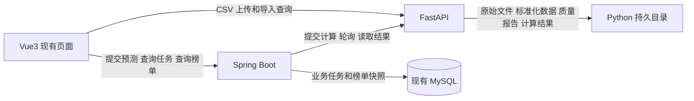

# CDN 热点文件动态预测与压缩降本系统 V1 开发设计

版本：20261020 v01。用途：指导第三阶段最小跨服务闭环开发，等待审阅后再 Coding。

本版以已完成的初始化和交互原型为基础，保留 Vue3、Spring Boot、MySQL、FastAPI 三服务架构。第三阶段只打通真实 CSV 导入、持久化任务、Python Mock 预测、Java Top50 聚合和页面展示。真实算法、回测、压缩业务及外部集成按后续阶段推进。

证据范围：完整读取考核题和实习日志的正文及表格、用户粘贴的 V1 原文，并逐行解析两个 CSV。当前工作区只有 `.git`，没有三工程源码；按用户后续指示“无需核实”，本次不进行代码核验。因此，“第一、二阶段已完成”来自用户确认；下文接口、字段及存储组织是拟定设计，不代表已存在。未连接数据库、未运行服务、未验证现有页面或执行迁移。

## 1 项目目标与考核要求

系统要回答未来哪些文件值得优先压缩，并逐步形成推荐、处理、效果追踪、提醒和模型复盘的闭环。第三阶段验收的是工程链路，不证明预测有效或产生真实降本。

| 最终考核要求 | 可追溯依据 | 对本阶段的约束 |
| --- | --- | --- |
| 基于近半年每日 Top100，预测未来日、周待压缩 Top50，严格时间滚动回测并比较方案 | 考核题 1.2、2.1、2.2 | 保留截止日、跨度、模型版本及不可变数据集；真实算法和回测后续实现 |
| 日榜为截止日之后的下一自然日，周榜为未来连续 7 天 | 考核题 2.2 术语表 | `horizonDays=1/7`；周预测不等于自然周 |
| 看板筛选、文件详情、压缩登记与效果观测 | 考核题 3.3 | 复用第二阶段页面，不重建原型；第三阶段只替换本链路的数据来源 |
| 表格包含排名、文件标识、类型、大小、预测流量、分数、理由、最近实际流量、压缩状态、模型版本 | 考核题 3.3.1 | 缺少真实来源的字段返回 null 或未知，不用假数补齐 |
| 按 App ID 和 fileKey 查询 CStore URL、文件大小，支持预览下载 | 考核题 1.2、3.3.1 | 后续 Java 按需调用，URL 不长期保存；文件信息请求不得超过 100 QPS |
| 压缩登记、质量门槛、有效访问和净收益 | 考核题 2.2、3.3.2 | 保留设计边界，本阶段不接真实压缩平台 |
| 飞书每日清单和超时提醒 | 考核题 1.2、3.4 | 后续复用同一业务榜单和处理记录 |
| Agent 查询实时数据，按 App 评估和替换模型 | 考核题 3.5 | 待真实回测可用后启用正式模型优化，不能用 Mock 指标选模 |
| 前后端分离，业务后端采用 Spring Boot，数据库建议 MySQL | 考核题 1.3 | 沿用现有技术栈，不因本次设计重建工程 |

有效压缩的考核口径为：7 天或 30 天观察窗口内仍有效访问；压缩率原则上不低于 30%；视频建议 VMAF≥90 或 SSIM≥0.95，或论证其他指标；正常播放或访问；估算净收益大于零。CDN 单价按题设 0.02 元/GB 使用，不将其写成外部实时市场价格。

考核题没有给出统一的最低预测准确率、接口延迟 SLA 或固定交付清单。本版不虚构这些门槛；最终需补齐可复现启动说明、数据字典、接口说明、真实滚动回测报告和演示材料。第三阶段验收标准见第 8 节。

## 2 当前开发进度

| 阶段或能力 | 当前认定 | 本版处理 |
| --- | --- | --- |
| Vue3、Spring Boot、MySQL、FastAPI 基础工程独立启动 | 第一阶段已完成，用户确认 | 不重复初始化，不更换技术栈 |
| Vue→Java→MySQL 页面、基础交互、Fake 数据及 Mock 逻辑 | 第二阶段已完成，用户确认 | 原样保留；新增跨服务数据入口，不覆盖原型数据 |
| 实际组件、接口、表名、列名、迁移工具及部署配置 | 未核实，用户明确免于本次核验 | 不宣称已实现；开发时先映射到已有能力，再决定最小增量 |
| CSV 真实上传、质量检查、数据集持久化及 Java→Python 预测 | 第三阶段待接通 | 本版主要设计对象；不能将原文目标描述当作现有实现 |
| 真实预测、真实回测、CStore、压缩效果、飞书和 Agent | 是否已有占位实现未核实 | 不列入第三阶段最小验收，不删除现有页面和占位接口 |

原方案中“数据导入真实实现”等表述调整为第三阶段目标。实习日志 10.19 的次日计划中出现“Java 转发”，与本次明确要求冲突；本版采用上传和导入查询直达 Python。日志只是历史记录，本次不修改日志。

本次改动保留三服务分工、HTTP、Conda、异步预测、不可变快照、日周窗口、精度与时间防泄漏约定。压缩、通知、Agent 和模型管理仅保留最终功能边界；删除大段重复环境操作命令、尚未验证的目录与 SQL 文件名示例，以及在第三阶段同时完成全部后续模块的隐含要求。

## 3 整体架构与技术选型



| 服务 | 第三阶段职责 | 不承担的工作 |
| --- | --- | --- |
| Vue3 | 上传、报告、数据集选择、预测提交、任务轮询、Top50 和来源标签 | CSV 业务解析、模型计算、收益计算、访问数据库 |
| Spring Boot | 业务参数校验、业务任务、调用 Python、校验结果、组织 Top50、保存可查询快照 | 文件转发、CSV 解析、预测算法、读 Python 内部文件 |
| FastAPI | 文件落盘、解析与质量检查、不可变数据集、计算任务、Mock 或真实算法、候选结果查询 | 压缩业务状态、费用、CStore、向 Java 回调 |
| MySQL | Java 业务任务、现有业务记录和榜单快照 | 新建与原始 CSV 等量的 Java 观测副本 |

Vue 沿用现有组件和 API 封装；若已有 Element Plus、ECharts，则直接复用，不要求为本阶段新增 UI 库。Java 和 Python 各自独立启动；Python 沿用原方案的 `cdn-predictor` Conda 环境。Java 21、Python 3.11 等属于原方案选型，本次未验证实际版本，不据此升级既有环境。

浏览器拟用 `/data-api/*` 代理到 Python `/api/v1/*`，`/api/*` 代理到 Java `/api/v1/*`。这是目标映射；已有业务路径优先保留，不能直接替换所有原型请求。代理不承担业务逻辑，文件仍不经过 Java。Java 使用 Python 服务地址直接发 HTTP，不绕浏览器代理。

本阶段采用单实例、单计算 worker 和简单持久存储。Java 的业务任务与 Python 的执行状态各司其职，不是两套调度系统。Python 完成计算后，Java 主动轮询并读取；不引入 MQ、Redis、Celery、分布式调度或 Python→Java 回调。

## 4 核心业务模块

| 模块 | 第三阶段最小功能 | 后续保留功能 |
| --- | --- | --- |
| 数据导入与质量检查 | 小 CSV 上传、映射、报告、数据集查询 | 大文件流式导入、更多适配器、正式完整性确认 |
| 热点预测 | 持久化任务、确定性 Mock、1/7 天同契约输出 | 昨日值、近 7 日均值、EWMA 等真实方案比较 |
| Top50 与看板 | 绑定 runId、展示来源和窗口、最多 50 条 | 待压缩榜单、CStore 信息、历史与效果趋势 |
| 指标与收益 | 占比的数据前提、不可计算状态；Mock 明确标识 | 真实热点占比、预测评价、预期收益和事后效果估算 |
| 压缩记录、通知、模型管理、Agent | 保留原型，不接入本次新链路的验收 | 人工登记、效果追踪、提醒、工具查询、按 App 模型优化 |

第三阶段只验收“预测热点 Top50”。“待压缩 Top50”在后续从全部候选中排除已有效压缩等不可执行项，并向后补位。不能把这两个榜单混成同一集合，也不能拿业务过滤后的榜单直接评价预测模型。

## 5 数据集与数据模型

### 5.1 两个 CSV 的实测含义

两个文件都能以 GB18030 解码，均含 4 列、文件标识、日期和 AppID。它们是文件级日流量观测记录，不是每个 App 每天只有一条的汇总表；也不能直接认定是题设的完整每日 Top100。

| 核查项 | 10066.csv | 10350.csv |
| --- | --- | --- |
| 原始表头 | `url,日期,日流量,AppID` | `文件标识,日期,当日流量（B）,AppID` |
| 数据行数，不含表头 | 1,048,575 | 4,478 |
| AppID | 全部为 10066 | 全部为 10350 |
| 日期首尾 | 2026-01-01 至 2026-04-16 | 2026-01-05 至 2026-10-13 |
| 有记录的日期数 | 106 | 248 |
| 首尾区间内缺失日期数 | 0 | 34 |
| 每日记录数范围 | 124～13,038 | 1～122 |
| 每日不超过 50 条的日期数 | 0 | 237 |
| 不同原始文件标识字符串数 | 389,898 | 952 |
| 科学计数法流量值 | 0 行 | 862 行 |
| 没有 http/https 协议前缀的标识 | 209,760 行 | 2,617 行 |
| 同 App 同日去掉协议后可能同源的标识组 | 59 组 | 105 组 |
| 精确原字符串键的重复或流量冲突 | 均为 0 | 均为 0 |
| Decimal 解析失败、负值或非整数字节值 | 均为 0 | 均为 0 |
| 单位证据 | 表头“日流量”未注明单位，待确认 B | 表头明确标注 B |

核查键为 `(AppID, 原始文件标识字符串, 日期)`。候选同源组只是身份冲突线索，不能自动视为重复：完整 URL、无协议域名路径及 CStore fileKey 的映射尚未确认，不能直接删域名、统一协议、删除查询参数或合并流量。当前没有足够依据证明文件覆盖完整性。

重要限制：

- `10066.csv` 数据行数加表头恰为 1,048,576 行，且末日只有 124 行。可能经过有行数限制的导出或截断，但这不是已证实事实；需核对导出来源和末日完整性。不能把它称为完整“今年以来”或完整半年数据。
- `10350.csv` 缺日表示无观测，原因可能是导出缺失、业务无数据或其他情况，不能直接补成零。多数日期不足 50 条，按观测集合求 Top50 占比会频繁得到 100%，不能据此宣称真实热点集中。
- 科学计数法应使用 Decimal 按文本解析，避免 float 中转。可以恢复文本所表示的整数 B，不能恢复导出前可能已被舍入的精度。
- 两个 CSV 均没有独立的 App 每日全量 CDN 统计字段。行流量相加只能命名为“已观测文件流量合计”，除非数据提供方确认这些行穷尽全部计费范围。

解析映射为：`日期→date`，`AppID→appId`，`url/文件标识→原始身份`，`日流量/当日流量（B）→trafficBytes`。第一份的 B 单位不得静默推断。标准化前必须明确 `sourceUnit`，并记录其确认来源。

### 5.2 数据分类和来源隔离

数据结构类型使用 `datasetType=FILE_DAILY` 或 `APP_DAILY_TOTAL`；数据来源使用 `datasetSource=REAL/FAKE`。二者独立：结构真实可解析，不等于内容属于真实业务数据。文件名不作为 AppID 的唯一依据。

预测运行另带 `predictionSource=MOCK/MODEL`。真实 CSV 输入也可以生成 Mock 预测，因此不得用 datasetSource 推断预测真实性。上述字段是稳定的来源元数据，真实算法上线后仍保留；Java 不据此选择算法分支，只用于展示和防混用。

现有 Fake 数据保持原记录、现有页面和既有标识，不删除、不覆盖、不重命名。新增结果必须有明确来源，缺少来源的旧记录归为“未确认”，不能默认 REAL。Mock 结果不纳入正式预测评价、真实收益证明或正式选模。

原方案“任何响应都不含 Mock 标识”调整为允许稳定的来源标签。仅写日志或说明书不足以保证刷新页面、查询历史和汇总时不误用数据；但不增加 `mockPrediction` 等平行接口，也不由 Java 判断模型版本前缀。

### 5.3 Python 如何保存数据集和计算结果

原始 CSV 只由 Python 保存，不复制到 Java。未核实既有持久层，本版以简单持久目录作为第三阶段最小落地基准；如果已有可用数据库实现，应复用它满足以下生命周期，不能为套用本版迁回文件。这里描述的是保存责任和必要内容，不要求新建一组 Python 业务表。

```text
<持久目录>/datasets/<datasetId>/
  original.csv       原始字节 不改写
  normalized.csv     标准化观测
  metadata.json      来源 类型 映射 单位 SHA256 日期范围 解析版本
  quality.json       质量报告
<持久目录>/imports/<importTaskId>.json
<持久目录>/tasks/<taskId>.json
<持久目录>/runs/<runId>/
  metadata.json
  items.json         完整候选快照
```

目录是设计示意，不要求现在创建。正式使用项目受控路径或持久卷，不能放进会随进程或容器销毁的临时目录；Java 不挂载或直接读取这些文件。

上传时先写临时文件，再原子发布原始文件和任务记录；返回 202 前必须保证上传内容及导入任务可恢复。只有标准化数据、元数据和质量报告完整发布后，数据集才变为 READY。失败不暴露可用于预测的 datasetId。文件落盘失败返回错误，不能假接收。

`datasetId` 是不可变快照：相同原文件 SHA256、映射、单位、App 默认值、来源、数据类型及解析规则版本可以复用同一 READY 数据集；这些条件变化则生成新 ID。失败重试不能把同一批观测追加两遍；新批次也不能默认与旧批次累计合并。

记录解析版本和身份映射版本，为将来回测重现输入。运行元数据保存 taskId，便于恢复结果已发布但任务状态未更新的情况。任务只读日期≤cutoffDate 的数据；改动截止日之后的观测不能改变此前预测。实际回测日期必须选择标签已成熟的窗口，不能沿用示例日期硬编码。

### 5.4 标识归属与生命周期

| 对象 | 创建和主归属 | 何时有效 | 关联和用途 |
| --- | --- | --- | --- |
| importTaskId | Python | 文件和导入任务持久化后 | 只查询导入，不是预测 taskId |
| datasetId | Python | 数据集 READY 后对外可用 | 一个数据集可产生多个预测任务；不随任务失败删除 |
| taskId | Java 创建业务 ID，原样传给 Python | Java 业务任务持久化后 | Java/Python 使用同一预测 ID，避免另加第二套预测 ID 映射 |
| runId | Python 完成预测后生成 | 全量结果完整发布后 | 对应一个不可变运行；Java通过它保存和查询榜单快照 |
| 原始预测结果 | Python | 该计算任务 SUCCEEDED | 全候选、窗口累计预测值及排序；不含业务状态 |
| Top50 快照 | Java | 校验和业务聚合完成且落库后 | 该 runId 的最多 50 条及汇总；不存第二份全部候选 |
| 业务状态及失败原因 | Java | 从 PENDING 到终态持久化 | 前端统一只查询 Java；Python 保存自己的执行状态供 Java 读取 |

第三阶段一个 taskId 至多发布一个 runId。技术重试使用原 taskId，不创建新运行；明确业务失败后的重新执行由用户重新提交并取得新 taskId。一个 datasetId 可关联不同截止日、跨度和模型的多个 taskId。

### 5.5 现有 MySQL 的最小增量

没有源码和 DDL 核验，因此这里不声称表存在、不指定真实表名、不提供或执行迁移 SQL。开发时先把逻辑字段映射到现有任务和结果表；只有缺少必要能力才增量补列或新增表，禁止重建第二阶段库表。

| 逻辑记录 | 必需字段或能力 | 必要性 |
| --- | --- | --- |
| Java 预测业务任务 | taskId、任务类型、datasetId、appId、cutoffDate、horizonDays、modelVersion、status | 固定请求身份与执行状态 |
| 幂等和恢复信息 | idempotencyKey、请求摘要、createdAt、updatedAt、deadlineAt、nextAttemptAt、attemptCount | 页面重试、服务重启和短暂网络故障不会重复业务任务 |
| 来源和错误 | datasetSource、predictionSource（完成后）、errorCode、errorMessage | 来源隔离，明确失败；不用任务错误冒充空榜单 |
| 成功结果 | runId 唯一、Top50 快照、top50PredictedBytes、候选总数、窗口和结果元数据 | Java 重启后无需重新计算；结果与榜单有确定关联 |

若已有结果表，任务引用它；若没有，可在任务记录中用 JSON 保存小规模 Top50 快照，不为最多 50 条预先拆一组明细表。成功状态、runId 和快照必须在同一数据库事务中发布。幂等键和 runId 需要数据库唯一性约束，而不只依赖内存判断。

后续确需变更数据库时，沿用项目现有迁移入口，新增迁移而不改写已执行历史；原方案中的 Flyway 是选型记录，本次不据此安装工具或重建迁移体系。

Python 原始数据和全量候选是计算依据；Java Top50 是供页面查询的业务投影，保留有限重复以支持业务原子发布和重启查询，不再复制全量观测或全量候选。不为热点占比新增独立指标库。

## 6 跨服务数据流转与接口契约

以下全部为第三阶段目标契约，尚未确认与现有路由的对应关系。开发前先核对现有接口；可兼容增加字段，不批量改名。JSON 中 ID 为字符串，日期为 `YYYY-MM-DD`，业务日为 Asia/Shanghai，执行时间为 UTC ISO 8601。流量字段用 B、非负十进制字符串，Java 使用 BigDecimal，不经浮点舍入；金额也使用十进制。

### 6.1 最小端到端流程

| 步骤 | 发起方→接收方 | 路径和请求 | 返回与持久化 |
| --- | --- | --- | --- |
| 1 上传 | Vue→Python | `POST /api/v1/imports`，multipart | 202：importTaskId、status；Python 已保存原文件和导入任务 |
| 2 查询导入 | Vue→Python | `GET /api/v1/imports/{importTaskId}` | 成功返回 datasetId；失败返回 error；Python 已保存标准化数据和报告 |
| 3 查看报告或重选数据 | Vue→Python | `GET /api/v1/datasets/{datasetId}`、`GET /api/v1/datasets/{datasetId}/quality`、`GET /api/v1/datasets?page=1&pageSize=20` | 元数据、报告、分页列表；不经 Java |
| 4 提交业务预测 | Vue→Java | `POST /api/v1/predictions`，datasetId 和预测参数 | 202：taskId、status；Java 任务已落 MySQL |
| 5 业务任务派发 | Java→Python | 先 GET 数据集校验，再 `POST /api/v1/predictions`，附相同 taskId | 202：相同 taskId、status；Python 已持久化执行记录 |
| 6 查询执行 | Java→Python | `GET /api/v1/tasks/{taskId}` | 状态、runId 或 error |
| 7 获取与聚合 | Java→Python | `GET /api/v1/predictions/{runId}/items?page=1&pageSize=50` | Python 候选；Java 校验、组织 Top50 并在 MySQL 发布快照 |
| 8 查询业务状态 | Vue→Java | `GET /api/v1/tasks/{taskId}` | Java 的业务状态；成功后才提供可查的 runId |
| 9 显示结果 | Vue→Java | `GET /api/v1/predictions/{runId}` | Top50 快照、来源、窗口及指标可用性 |

同样的 `/api/v1/predictions` 在两个服务中职责不同，由服务地址区分。Vue 只向 Java 提交预测；Java 主动请求 Python，Python 只返回响应。

### 6.2 上传与质量报告

multipart 字段：`file`、`mapping`（JSON 字符串）、`datasetType`、`datasetSource`、`sourceUnit`，以及 CSV 缺少 AppID 时才必填的 `appId`。请求头携带 `Idempotency-Key`。目前两个 CSV 均已有 AppID；若用户另传 appId，应与行值一致，否则拒绝。

第三阶段建议限制单文件≤5 MiB、数据行≤20,000，作为待审阅的本地联调配置，不是考核标准。整份 10066.csv 约 107.7 MB，不属于本阶段小样本上传目标；不能为让它通过而静默截取前 20,000 行。后续大文件适配另验收。第一份数据源单位未确认前，不输出声称为 B 的真实预测。

```json
{
  "importTaskId": "imp_example",
  "status": "SUCCEEDED",
  "datasetId": "ds_example",
  "error": null
}
```

这是查询成功示例。上传提交响应仅含 importTaskId 和 PENDING 状态。未成功时 datasetId 为 null；失败时 error 包含 code、message。importTaskId 专用于导入，调整了旧文档将其也命名为 taskId 的歧义。

质量报告至少包含：encoding、总行数、有效行数、完全重复行数、冲突行数、异常行数、日期范围、缺失日期、每日行数、单位确认状态、文件身份状态、完整性状态、warnings。状态的含义分开：READY 表示可读取；`completeness=UNKNOWN/CONFIRMED/INCOMPLETE` 表示覆盖可信程度，导入成功不自动等于完整。

规则：UTF-8 BOM/UTF-8 优先，失败后尝试 GB18030 并记录实际编码；不静默忽略乱码。非法日期、空身份、非法或负流量、同键冲突属于阻断错误，整批失败并保留报告。完全相同的键和值可去重并计数。缺日和身份待核对可作为警告保留，不能填零或无依据合并；正式预测、评价及真实占比再按各自前提检查。FILE_DAILY 才可做文件预测，APP_DAILY_TOTAL 返回类型不支持。

上传幂等以同一键与相同文件内容及导入配置绑定；重复请求返回原导入任务，相同键而内容不同返回 409。响应丢失后使用原键重试即可，不需要另建恢复接口。

### 6.3 预测提交和稳定输入

Vue→Java 的请求示例（仅示意，不对应已导入的数据集）：

```json
{
  "datasetId": "ds_example",
  "appId": "10350",
  "cutoffDate": "2026-10-06",
  "horizonDays": 7,
  "modelVersion": "contract-demo-v1"
}
```

Java 返回 `202 {"taskId":"task_example","status":"PENDING"}`。同一用户的同一逻辑提交携带相同 `Idempotency-Key`；相同键和请求体返回已有任务，不同体返回 409。现有系统若无登录，则第三阶段按单一演示调用者确定幂等范围，不虚构租户系统。

Java 先做本地结构校验并持久化 PENDING 任务，再由后台 worker 校验 Python 数据集并提交计算，不占住浏览器请求等待 10～100 秒。数据集不存在、App 不匹配或类型不支持等语义错误会进入可查询的 FAILED 业务任务；POST 的参数格式错误直接返回 422，不创建任务。

Java→Python 使用同样的五个业务字段，额外带上 Java 创建的 `taskId`；Python 对此 ID 做持久化幂等，相同 ID 和相同参数返回已有状态，不同参数返回 409。Java 不发送 `mock=true`，Python 内部配置选择实现。

`cutoffDate` 必须是该 App 数据范围内的日期；文件候选只能来自此前已观测的身份。Mock 允许有质量警告的真实观测小样本用于链路验证，但不能声称覆盖完整。未来真实算法若不满足最小历史要求，返回明确的业务错误，不静默回退 Mock。

### 6.4 任务状态与持久化恢复

任务统一为 `PENDING → RUNNING → SUCCEEDED/FAILED`。Python 的成功只表示算法结果可查；Java 必须完成获取、校验和榜单落库后才成功。暂不承诺可计算的百分比进度，响应可含 `stage=WAITING/VALIDATING/COMPUTING/AGGREGATING/COMPLETED`。

```json
{
  "taskId": "task_example",
  "status": "SUCCEEDED",
  "stage": "COMPLETED",
  "datasetId": "ds_example",
  "runId": "run_example",
  "error": null
}
```

未完成时 runId 和 error 均为 null。失败时 runId 为 null，error 如 `{"code":"DATASET_NOT_FOUND","message":"数据集不存在"}`。Python 同 ID 查询返回的是执行状态；前端统一展示 Java 业务状态。业务失败不删除 Python 已完成但未发布到 Java 的结果，也不覆盖上一份有效榜单。

拟定联调参数：Vue 每 2 秒查询 Java；Java 对活跃 Python 任务每 2 秒查询。单次连接超时 3 秒、读取超时 5 秒；单任务总截止时间 180 秒，兼容预期的 10～100 秒算法，不是性能承诺。使用有限后台执行器，单计算并发，其他任务留在持久化 PENDING 中；避免为每次轮询无限创建线程。

临时网络错误、503 或单次 HTTP 超时不等同算法失败；按任务记录做有界退避重试，沿用 taskId。超过总截止时间后 Java 记录 TASK_TIMEOUT；第三阶段不提供取消接口，Python 可能稍后完成，其迟到结果不自动发布为已失败业务任务。要再执行需新业务任务。

重启规则：

1. Python 启动扫描导入任务、计算任务和持久目录，READY 数据集及已完成运行可继续查询；未完成导入有完整已发布数据集则补齐成功，否则可将 PENDING 重入队、RUNNING 标为 IMPORT_INTERRUPTED。孤立临时文件不视为 READY，不自动清理正式目录。
2. Python 的 PENDING 可以重入队；上次遗留 RUNNING 先检查是否已有完整结果，有则补齐成功状态，没有则标记 EXECUTION_INTERRUPTED。第三阶段不做算法断点续跑或自动无限重算。
3. Python 先原子发布完整结果和关联 runId，再发布成功任务状态，不能出现 SUCCEEDED 却读到半份 items。
4. Java 启动恢复未终结任务，先按 taskId 查询 Python；404 时才以原 ID 幂等提交，已成功则继续聚合，已失败则同步原因；数据库中的成功任务直接返回已有快照。
5. Java 聚合失败或进程中断后可重新读取同一 runId；事务与唯一约束防止双份榜单。第三阶段不做结果自动清理，避免破坏历史查询。

### 6.5 Python 输出与 Java Top50

Python 保存全部候选的窗口累计预测，不只保存前 50。对外分页从 1 开始，pageSize 为 1～200；total 为候选总数，rank 为全局名次。空结果返回空数组和 total=0，不伪造文件凑满 50。

```json
{
  "runId": "run_example",
  "datasetId": "ds_example",
  "appId": "10350",
  "cutoffDate": "2026-10-06",
  "horizonDays": 7,
  "predictionStartDate": "2026-10-07",
  "predictionEndDate": "2026-10-13",
  "modelVersion": "contract-demo-v1",
  "datasetSource": "REAL",
  "predictionSource": "MOCK",
  "generatedAt": "2026-10-06T16:05:00Z",
  "items": [
    {
      "fileKey": "example/file-a.mp4",
      "rank": 1,
      "predictedBytes": "5000000000",
      "score": 0.92,
      "reason": "模拟结果 仅验证链路"
    }
  ],
  "page": 1,
  "pageSize": 50,
  "total": 1
}
```

示例身份和数值均为契约占位，不是 CSV 实测结果。predictedBytes 是整个预测窗口的累计流量，不是文件大小或每日均值。score 是有限排序分数，不解释成概率，不默认跨模型可比。日期首尾均包含。候选按 predictedBytes 降序，相同时按精确 fileKey 固定顺序排序。

Java 校验 runId、datasetId、App、截止日、跨度及模型与原任务一致，检查身份唯一、非负有限流量、稳定名次；收到错误契约应失败，不默默修补成看似正确的榜单。模型负责每文件窗口累计预测，Java负责选择最多 50 条、关联现有业务状态、求 Top50 流量和并发布快照，不重复运行模型或再次累加已经累计的周流量。

第三阶段预测热点榜只需取第一页 50 条。后续待压缩榜排除不可执行项时，才继续读后续候选补位。文件实时大小、CStore URL、成本及压缩状态不由 Python 伪造；未知业务字段为 null。原始 URL 暂只能作为不透明观测身份，不能承诺已是 CStore 可用 fileKey；正式映射确认后重建数据快照，接口字段不变。

Java 的结果响应复用运行元数据，增加 `candidateCount`、`top50Count`、`top50PredictedBytes`、`items` 和 `hotspotTrafficRatio`。Top50 只绑定明确的 runId；页面“最新”若有多个来源必须显式选择，不把 Fake 或 Mock 结果覆盖进已有真实看板汇总。

### 6.6 Mock 约束与异常约定

Mock 与未来算法共用标准化输入、任务、存储、序列化及结果结构。相同快照和业务参数输出相同候选及数值；ID 和执行时间可不同。候选只能来自 cutoffDate 及以前，数值明确是模拟值。真实算法只替换 Python 内部预测函数和模型配置；HTTP 版本、Java 业务编排及 Vue 任务流程保持不变。

HTTP 错误采用 `{"error":{"code":"...","message":"..."}}`；后台失败使用任务响应中的同结构 error。404 表示标识不存在；409 表示幂等冲突或资源未就绪；413 表示超限；422 表示字段、数据或业务参数不合法；503 表示依赖暂不可用。稳定错误码至少覆盖 INVALID_CSV、UNIT_UNCONFIRMED、DUPLICATE_CONFLICT、DATASET_NOT_FOUND、DATASET_TYPE_UNSUPPORTED、APP_MISMATCH、INSUFFICIENT_HISTORY、IMPORT_INTERRUPTED、EXECUTION_INTERRUPTED、INVALID_RESULT、TASK_TIMEOUT。

Vue 失败后显示原因并停止成功分支；网络查询失败允许重试原任务，不能自动创建新任务。日志用 traceId 关联单次 HTTP，并记录 datasetId、taskId、runId；不打印密钥、签名 URL 或整份原始记录。现有登录保护若启用，应同时覆盖 Python 上传入口；不在第三阶段另建认证中心。

## 7 关键业务指标

### 7.1 热点流量占比

定义统一的统计口径标识 scope：AppID、时区、时间首尾、流量单位、CDN 下行范围、业务或计费边界及数据来源版本。分子分母必须完全匹配；不混用文件大小与访问流量、不混用历史与预测、不把两个 App 合并后再冒充单 App 指标。

| 指标 | 分子 | 分母 | 可说明什么 |
| --- | --- | --- | --- |
| 历史实际 Top50 占比 | 同期真实全量文件按流量排序的前 50 项实际流量 | 同期真实 App 全量 CDN 流量 | 事后真实集中程度 |
| 预测 Top50 预期占比 | 预测选出的 50 文件在目标窗口的预测流量 | 同一未来窗口、同口径的 App 总流量预测 | 预期集中程度；分子分母均需预测且可追溯 |
| 预测名单事后实际覆盖占比 | 预测时已固定名单在目标窗口的实际流量 | 同期真实 App 全量 CDN 流量 | 提前选出的文件实际覆盖了多少流量 |
| 观测集合内 Top50 占比 | 仅已观测文件中的 Top50 实测流量 | 已观测文件流量合计 | 样本内部集中程度；不能命名为真实 App 热点占比 |

统一公式：`占比 = 分子累计流量 / 分母累计流量 × 100%`。分母为零、缺失、不完整或口径不匹配时返回 value=null 和 reasonCode；不能返回 0%。比例超过 100% 应报告口径或数据异常，不截断成 100%。预测分子除以历史总流量只能是另有说明的情景比较，本版不把它纳入热点占比。

日口径：上海自然日 [00:00, 次日00:00)，App 不变，先按稳定文件身份汇总该日流量，再选当日实际 Top50；实际全量总流量为同日分母。预测日为 cutoffDate+1。

周口径：先对同一个未来或历史连续 7 天窗口按文件累计，再选周期固定 Top50；分母为这 7 天 App 总流量之和。计算 `Σ窗口Top50文件流量 / Σ窗口App总流量`，不简单平均每日百分比，也不把每日不同 Top50 的分子相加后称为“周 Top50”。如果以后另展示“每日动态名单的周覆盖”，必须单独命名。

只有分子是同一定义的逐日分解时，分母加权的日占比才能还原该周期占比。缺任何一天都标记窗口不完整，不能把 6 天显示成完整 7 天。

### 7.2 当前能算到哪里及如何接入

当前可算文件观测合计、观测集合内部排名和缺失分布；不可直接计算可声称代表两个 App 的真实热点占比。原因包括全量覆盖未确认、10066 单位待确认、文件身份待核对、导出截断疑点和 10350 缺日。尚不能判断哪个 App 真实更集中，或真实热点是否值得压缩。

所缺数据或证明：

1. 按 App、自然日、B 输出的权威 CDN 总流量，注明统计域名、区域、状态码、去重、计费范围及时区；或能证明现有文件明细穷尽相同范围的导出说明。
2. 稳定文件身份映射及完整日 Top50 标签或足够完整的文件明细。只要权威完整 Top50 可知，实际占比分子无需为了本指标另建全文件库。
3. 10066 的单位与导出完整性确认、10350 缺日原因及修正数据；计算科学计数法数据时注明源精度限制。
4. 预测占比还需要未来同窗口 App 总流量预测，本阶段不为此新增总量预测模型。可先做历史实际占比，不强行给预测榜套用真实百分比。

后续将总量 CSV 作为 `APP_DAILY_TOTAL` 由同一个 Python 导入模块接收，列为 `date,appId,totalTrafficBytes`，不含 fileKey；Java 通过 HTTP 获取对应窗口的标准化统计摘要，在现有看板查询逻辑中计算一次占比。不能让总量数据集进入文件预测。当前阶段只保留类型识别和不支持时的明确错误，正式总量导入适配及统计查询在数据到位后再做，不现在增加一套接口或表。

最合理位置是在现有 Top50 看板的 App、日期、粒度筛选区下方、榜单上方放一张卡片，和榜单共用筛选条件。优先展示“历史实际热点占比”，明确它对应历史窗口；不因页面同时展示未来榜单而偷偷切换分母。以后在原趋势区域增加日或 7 天趋势及双 App 同口径对比，不新建独立子系统。

第三阶段 Java 响应中预留的卡片状态为：

```json
{
  "hotspotTrafficRatio": {
    "metricBasis": "PREDICTED_TOP50_FORECAST",
    "value": null,
    "numeratorBytes": "5000000000",
    "denominatorBytes": null,
    "numeratorSource": "MOCK",
    "denominatorSource": null,
    "reasonCode": "MOCK_RESULT_AND_NO_MATCHING_TOTAL"
  }
}
```

value 约定为 0～1 的无量纲比例，Vue 格式化成百分数；metadata 的 App 和窗口继承外层运行且不得不同。这个示例只证明不可计算状态传递，不是一个真实比例。

可选 UI 联调可以同时构造模拟文件明细和模拟 App 总量，让二者均标 FAKE/MOCK，并用同一公式得出模拟占比；与真实总量隔离，不把 Mock 分子配真实分母写成业务结论。第三阶段不要求额外制造这套数据。

### 7.3 预测效果与截断观测

真实算法阶段至少比较简单基线和其他候选方案，在同一 App、跨度、快照、成熟标签窗口下做时间滚动回测，禁止随机切分未来数据或使用 cutoffDate 后首次出现的文件作当时可知候选。

- Precision@50：预测名单与可确认的实际 Top50 交集数，除以预测名单实际条数（最多 50）；同时报告 predictionCount、labelCount 和有效窗口数。空名单返回 null；不足 50 条不能包装成完整 Top50 场景的等价成绩。
- NDCG@50：使用实际窗口流量作为非负线性相关度，DCG 为各名次相关度除以 log2(rank+1) 后求和，除以固定评价候选全集的理想 DCG；不能只用预测选中项构造理想榜单。明确相关度和候选范围，分母为零返回 null。
- Top50 流量捕获率：预测名单的实际流量之和 / 真实 Top50 实际流量之和。它衡量预测选择，不是除以 App 总量的“热点流量占比”。缺少名单内文件实际流量时返回不可确认或可证明的边界，不能把未入榜流量填零。

每日 Top100 若被确认完整，可确认当日 Top50 的成员标签；未入 Top100 不代表真实零流量。日 Top100 联集只能提供周累计的截断观测，未必能恢复真实周 Top50，因此周代理评价必须命名 `OBSERVED_WEEKLY_TOP50`，与完整标签的评价分开。Mock 不输出用于正式决策的准确率；第三阶段模型效果区显示“尚未评估”。

### 7.4 热点占比与预期净收益

热点占比高表示所选文件有流量覆盖潜力，不直接证明值得压缩。每个文件还需预测流量、压缩率、压缩版本承接比例、转码成本、新增存储成本、质量和兼容性证据。

`预计节省流量B = Σ(文件预测窗口流量B × 承接比例 × 压缩率)`

`预期净收益元 = 预计节省流量B / 10^9 × CDN单价元每GB − 转码成本元 − 同一观察窗口新增存储成本元`

其中 `压缩率=1−压缩后大小/原大小`，1 GB=10^9 B。CDN 单价用题设 0.02 元/GB，成本和窗口必须可追溯；承接比例不是自动等于 1，成本不是默认等于 0。参数未知返回 null 和缺失项，显式场景假设可以做情景估算，但必须展示假设。

在同范围、压缩效果和承接比例可以合理加权的前提下，可用“总流量×热点占比×有效压缩比例”解释节省潜力；实际收益计算仍按文件累计，避免平均值掩盖文件差异。Mock 流量得到的收益只验证公式。事后真实账单节省还需要可解释的反事实或对照及实际计费数据，不把文件体积差或预测估算标成已实现降本。

## 8 分阶段开发计划

### 8.1 第三阶段拆分与验收

以下是审阅后的开发顺序，本次只交付设计，不执行任何一步 Coding。

| 小步骤 | 最小改动范围 | 独立验收方式 |
| --- | --- | --- |
| 0 对照已有实现 | 查已有导入页、任务接口、任务表、榜单和代理，填写本契约的映射 | 列明复用和缺口；不删除原型，不重建数据库 |
| 1 Python 真实导入 | 先完成 POST imports、导入任务查询和质量报告，沿用现有持久层 | 上传一份小 FILE_DAILY CSV，取得 READY datasetId；重启仍可查询；坏文件无可用 datasetId |
| 2 Vue 导入纵向验证 | 现有页面接 Python，展示报告和 datasetId | 浏览器网络记录证明文件未经过 Java；刷新可重新选已导入数据 |
| 3 Python 异步 Mock | Java taskId 对应的提交、任务查询、runId 结果与持久化 | 独立 HTTP 请求能从 PENDING 到 SUCCEEDED；可切短 Mock 和延迟 Mock，响应结构相同 |
| 4 Java 编排与快照 | 现有业务任务、HTTP client、轮询、Top50 发布 | 不依赖 Vue 即可提交 datasetId；最终按 runId 查到 MySQL 快照；超时和失败可追溯 |
| 5 Vue 展示真实链路 | 复用现有预测提交、任务页和 Top50 表格 | taskId→runId 链路可追踪；表格对应上传数据集；来源和窗口明确 |
| 6 边界验收 | 只补上述闭环必须的异常处理 | 重试、重启、错误数据、错 App、来源隔离和不可计算指标满足下列标准 |

第一个需要实现的最小任务是步骤 1：Python 接收一份小 CSV、保存原文件、生成质量报告并返回可查询的 READY datasetId。先通过 HTTP 独立验证，再让 Vue 接入；不同时开发真实算法、压缩或 Agent。步骤 0 是开工前的只读映射，不重复本轮已获豁免的代码审查交付。

首份联调数据优先使用 10350 的少量原始行或已有明确标识的小 fixture，保留真实来源、原单位及原始身份，不在本轮生成。要验证满 50 条，应在所选 cutoffDate 之前有≥50 个不同候选；不足时验收实际条数，不补造真实文件。另用独立 FAKE 样本验证可控排序。

第三阶段完成标准：

1. 上传和导入查询直达 Python，Java 不接收 CSV；导入有真实持久化及质量报告，不是返回固定 datasetId。
2. datasetId→taskId→runId 可追溯，Java 只有在榜单快照完整落库后才成功；Vue 可按 runId 刷新查询同一结果。
3. Mock 的候选来自截止日前的文件，最多展示 50 条，排序和累计单位正确；Java 对样例求和与 Python 候选一致，不重复累加周流量。
4. 相同幂等键重试不新增导入或预测业务任务；不同请求体复用同键得到 409；双击提交和提交响应丢失都不产生重复榜单。
5. 用同一契约分别验证短 Mock 和 100 秒延迟 Mock，浏览器提交及时拿到 202，轮询可见状态；超 180 秒得到明确超时，无迟到结果覆盖。
6. Python 和 Java 分别重启后，READY 数据集和成功结果仍可查询；中断任务依本版恢复或显式失败；不会一直显示虚假 RUNNING 或发布半份结果。
7. 非法 CSV、同键冲突、类型不支持、错 App、缺失 datasetId、Python 暂停和错误结果结构都有明确反馈，失败不变成 0 行成功榜单。
8. GB18030、科学计数法、缺日和身份警告可见；未来观测不进入当前候选，未知实际流量不补零。
9. 原有 Fake 原型仍能按原方式演示；新结果有来源标签；真实热点占比缺少分母时显示不可计算，Mock 不写入正式模型效果和真实收益。

这些是拟定验收项，本轮没有运行它们。验证范围集中在真实跨服务闭环和可能影响业务结论的边界，不铺设无关的大规模测试体系。

### 8.2 后续演进与少量亮点

| 分级 | 功能 | 业务价值与数据前提 | 复杂度与建议时机 |
| --- | --- | --- | --- |
| 本阶段必需 | 导入质量报告和来源标签 | 防止把样本、Mock、缺日误当真实；现有 CSV 即可验证 | 低至中，与导入及结果展示一起做 |
| 本阶段必需 | 异步预测和重启查询 | 未来 10～100 秒算法无需重构调用链；需要持久目录和 MySQL | 中，第三阶段主线 |
| 后续实现 | 历史实际热点占比卡片与趋势 | 判断流量集中程度；需匹配的权威总量和可确认 Top50 | 低至中，数据到齐后复用看板；本阶段只处理不可计算状态 |
| 后续实现且最终考核必需 | 真实算法及日周滚动回测 | 有证据选择模型；需正式数据、身份映射、成熟标签 | 中，闭环通过后先比较简单基线 |
| 后续实现且最终考核必需 | CStore、压缩登记和效果收益 | 使预测能落实到处理和降本；需协议凭证、大小、质量和成本 | 中，按需访问和人工登记起步 |
| 后续实现且最终考核必需 | 飞书与实时 Agent | 清单运营、漏处理提醒、模型复盘；需稳定业务查询和真实指标 | 中，复用已有 API，不建立旁路统计 |
| 可选增强 | 单价或压缩率情景估算 | 展示不同假设下的收益敏感性；需可追溯假设 | 低，收益公式验证后复用详情页 |

考核必选功能不能因为不在第三阶段而被删除，只是分期交付。可选增强不得阻塞必选主线。

## 9 功能边界与暂不实现事项

- 本轮只输出设计和验收方案，不编写或改动业务代码、不生成 fixture、不执行迁移、不安装依赖、不启动服务、不提交或推送。
- 第三阶段不重建第二阶段页面、Fake 数据、数据库或接口；不把所有占位模块一次性真实化。
- 不引入消息队列、缓存集群、分布式锁、自动扩缩容、微服务治理、新认证中心或独立指标子系统。
- 不做真正转码平台、自动下载压缩、自动覆盖线上文件；考核允许人工压缩登记，但结果不能伪造。
- 不做正式滚动回测、模型自动替换、Agent 自主改代码或全量外部集成；也不以 Mock 数值作为这些功能已完成的证据。
- 不新增预测 App 总量模型来填补分母；不把文件行求和自动认证为全量总流量；不对缺日补零、不简单平均日占比。
- 不在本阶段承诺百万行 CSV 的性能、算法中断续算、在线取消、自动数据清理或多实例并行一致性。

开工前或相关功能前需要确认：现有接口及表的映射；10066 单位和导出完整性；文件身份到 CStore key 的规则；10350 缺日原因；权威 App 总量的统计边界；正式半年 Top100 的来源；质量、承接比例与成本参数。它们不阻塞用明确标注的 Mock 验证服务链路，但会阻塞对应真实业务结论。

本版材料来源：

- 考核要求：`E:/cache/sync-disk/OneDrive/Desktop/cvte/考核题：CDN 热点文件动态预测与压缩降本系统.docx`，重点为 1.2、2.1、2.2 和 3.3～3.5。
- 历史记录：`E:/cache/sync-disk/OneDrive/Desktop/cvte/吴昔-实习日志.docx`，10.19 内容；10.20 及以后记录为空，不能据此推断开发结果。
- 原 V1：`D:/codex-workspace/attachments/037257ed-a66b-4383-862f-fe201eda971b/已粘贴的文本.txt`，用户确认该粘贴文本即现有 V1。
- 数据：`E:/cache/sync-disk/OneDrive/Desktop/cvte/datasets/10066.csv`，SHA256 `abe5f6608aa1c56fea1578af86917e4163a57497bca56848ed4763b9c97712d2`。
- 数据：`E:/cache/sync-disk/OneDrive/Desktop/cvte/datasets/10350.csv`，SHA256 `838e0889e7c112cc22e485977ee2cd96268464046731abcf229da8514f4fad3a`。

附件中的目录规划、命令和操作建议按设计材料审阅，不视为本轮执行授权。本版为对粘贴 V1 的重构文档；保留附件原文，交付后停止并等待审阅。
